# Split-Sync

> A modern Progressive Web Application for seamless smart group expense management, bill splitting, and group payment tracking with integrated payment solutions built as a Final Year Project at SETU Carlow.

### Links
- **Live Demo**: [https://splitsync-dev.web.app](https://splitsync-dev.web.app)
- **GitHub**: [https://github.com/EmmanuelAbolade/Split-sync](https://github.com/EmmanuelAbolade/Split-sync)
- **Screencast**: [Watch on YouTube](https://youtu.be/7uat5PeTsrI?si=0_pGz91OvCN4-UQ6)
- **Doxygen Documentation**: [https://splitsync-docs.netlify.app](https://splitsync-docs.netlify.app)
- **Test Coverage Report**: [https://splitsync-coverage-test.netlify.app](https://splitsync-coverage-test.netlify.app)
- **Documentation**: [View Docs](./docs)
- **Showcase URL**: [https://showcase.setu.ie/C00288657/index.html](https://showcase.setu.ie/C00288657/index.html)

## Highlights

Split-Sync started as my final-year project at SETU Carlow and I've kept improving it since grading, for real users. I designed and built the whole thing: the React PWA, Firestore data model and security rules, Cloud Functions, admin panel and test suite.

- **Data integrity:** a clear membership lifecycle. People who leave lose access instantly, but their history is kept so everyone's balances stay correct. Account deletion is blocked until all debts are settled and never touches shared records.
- **Security and privacy:** expenses are readable only by group members, and joining a group can't be combined with any other change. Payment details and phone numbers live in an owner-only private profile; group members get only what they need to pay you, through a Cloud Function that checks membership. Bank details are encrypted server-side with AES-256-GCM, with keys in Secret Manager. All of this is enforced by Firestore rules covered by emulator tests.
- **Quality:** about 1,500 automated tests (Jest and React Testing Library, Firestore rules on the emulator, Node unit tests for the Cloud Functions).
- **AI:** an in-app Claude assistant, served through a Cloud Function so the API key stays on the server, with prompt caching to keep costs down.
- **Operations:** an admin panel (Taskmaster) with live platform stats, growth by month, user suspension, financial oversight, keyword-based content moderation and system-wide announcements.


## Table of Contents

- [Overview](#overview)
- [Features](#features)
- [Tech Stack](#tech-stack)
- [Getting Started](#getting-started)
- [Installation](#installation)
- [Configuration](#configuration)
- [Usage](#usage)
- [Security & Privacy](#security--privacy)
- [Running Tests](#running-tests)
- [Project Structure](#project-structure)
- [Security](#security)
- [Contributing](#contributing)
- [Roadmap](#roadmap)
- [Academic Context](#academic-context)
- [License](#license)
- [Acknowledgments](#Acknowledgement)
- [Contact](#contact)


## Overview

**Split-Sync** is a full-featured expense management and bill-splitting Progressive Web Application (PWA) designed to simplify financial tracking for groups to track costs, calculate who owes who, and settle debts directly through integrated payment methods, maybe its family, roommates, travelers, event planners and friends, Split-Sync ensures accurate expense tracking, automated balance calculations, and seamless settlements.

### Why Split-Sync?

- **Privacy-First Design**: Bank details encrypted server-side, membership-scoped data access, secure authentication, and privacy-preserving contact sync
- **Personal Expense Tracking**: Private trackers for your own spending and receipts, no invite needed
- **Multiple Payment Methods**: Integrated PayPal, Revolut, and SEPA bank transfers
- **Progressive Web App**: Install on any device, and have native app experience
- **Multi-Currency Support**: EUR, USD, GBP with automatic currency handling
- **Smart Contact Sync**: Find friends using Split-Sync through privacy-preserving phone number matching
- **Real-Time Notifications**: Instant updates for expenses, settlements, and group activities
- **Advanced Split Methods**: Equal splits, percentage-based, exact amounts, and shares
- **Receipt Scanning**: OCR-powered receipt scanning with Google Cloud Vision API


##  Features

### Core Functionality

#### **User Management**
- **Secure Authentication**: Email/password and Google OAuth 2.0
- **Biometric Authentication**: WebAuthn-based fingerprint/face recognition for payment confirmations
- **Session Management**: Configurable auto-logout (5min, 10min, 20min, 30min, never)
- **Profile Management**: Customizable profiles with photo uploads via Cloudinary
- **Privacy-Preserving Contact Sync**: SHA-256 hashed phone number matching

#### **Group Management**
- **Flexible Group Creation**: Custom icons, names, and currencies
- **Shared Groups or Personal Trackers**: Shared groups need at least one other member before expenses can be added; personal trackers are private, need no invite, and support receipt scanning with no splitting
- **Multiple Invitation Methods**:
  - Quick Add from previous connections
  - Contact sync (find friends via phone contacts)
  - QR code scanning
  - Shareable invite links via whatsApp, SMS, Email etc.
- **Real-Time Updates**: Live expense and member updates via Firestore subscriptions
- **Group Management**: Leave or delete a group with unsettled balance protection.
- **Membership Lifecycle**: Members who leave lose all access and can only return through the invite link. Their past expenses and settlements stay in the group (so everyone's balances and history remain correct) and keep showing their name, marked "(left)"
- **Safe Account Deletion**: Blocked until all balances are settled; removes you from shared groups without deleting shared history, hands owned groups to another member, and erases personal data
- **Group Currency**: Each group maintains its own currency — no cross-currency conversion is applied to prevent confusion

#### **Expense Entry and Tracking**
- **OCR receipt scanning**: Extract merchant name, total amount, transaction date and returns structured expense metadata
- **Four Split Methods**:
  1. **Equal Split**: Divide equally among selected participants
  2. **Percentage Split**: Custom percentage allocation (auto-adjusts to 100%)
  3. **Exact Amounts**: Specify exact amount per person
  4. **Shares**: Split by share ratios (e.g., 2:1:3)
- **Rich Expense Details**: Categories, descriptions, dates, receipts
- **Expense Categories**: Expense categories with distinct icons
- **Expense History**: Complete activity timeline with filters; each entry links back to its group with the expense highlighted
- **Settlement Suggestions**: Smart balance calculation and optimal settlement paths
- **CSV and PDF Report Export**: Report generated for use in spreadsheet and printable browser print dialogue
- **Expense Management**: Edit, archive, or remove expenses (creator only). 
  Archived expenses stay in balances but are hidden from the active list and 
  can be restored. Removed expenses are excluded from balances and cannot be undone
- **Built-in Split Calculator**: Inline number pad inside the Add Expense modal — 
  calculate amounts directly without leaving the app. Available on the amount 
  field (inserts result) and the Exact Amounts split section (copies result for 
  pasting into member fields)

#### **Payment Integration**
- **PayPal Integration**: Direct payment links with PayPal
- **Revolut Support**: Payment links for Revolut users
- **SEPA Bank Transfers**: IBAN validation and transfer details. Quick payment Options with copy button for manual bank transfer. SEPA Demo Simulation availble in future feature panel. 
- **Manual Settlements**: Mark payments as sent/received offline outside the app
- **Payment confirmation**: Payee confirms or declines receipt
- **Biometric Confirmation**: Secure payment authorization
- **Amount Validation**: Method-specific limits (PayPal: €0.01-€60,000, SEPA: €0.01-€999,999.99)
- **Personal Payment Activity**: My Payment Activity section tracks all payment statuses in real time
- **Dashboard Settlement Suggestion**: Highlights your highest outstanding debt 
  across all groups with a direct Settle shortcut
- **Payment Retry**: Declined payments show a Retry button in My Payment Activity 
  inside each group

#### **Notifications System**
- **Real-Time Notifications**: Bell icon with unread badge
- **Notification Types**:
  - Payment notifications (bidirectional)
  - New expense notifications
  - Group invitations
  - Settlement confirmations
- **In-App Notifications**: Dropdown with action buttons
- **Invitation Banners**: Prominent accept/decline UI

### **Profile and Payments**
- Payment settings protected by biometric or password authentication
- Payment details and phone number stored in an owner-only private profile; group members only receive the payment options they need, via a membership-checked Cloud Function
- IBAN encrypted server-side (AES-256-GCM, key held in Secret Manager) and only ever shown to its owner and people who share a group with them
- PayPal, Revolut, and SEPA payment methods supported
- Input validation enforced on all payment fields with strict length limits
- Display name changed, sync across Firebase Auth, Firestore, and all group member arrays in real time
- Tapping Owed to You or You Owe on the Profile page opens a balance breakdown 
  showing which groups and people make up that total

### **Analytics**
- Spending Over Time chart (last 6 months)
- Monthly Summary bar chart
- Category Breakdown pie chart
- Per-Person Balance chart
- Who Owes Who summary
- Group selector to filter all charts to a single currency

### **Security**
- Email/password and Google OAuth authentication
- WebAuthn biometric login (fingerprint and Face ID) per device
- Configurable session timeout with auto-logout warning
- All routes protected — unauthenticated users are redirected to login
- Firestore security rules: expenses are readable and writable only by members of their group; only owners can delete groups; payment notifications can only be changed by the people involved; suspended accounts cannot write. Rules are covered by emulator tests
- API keys and the IBAN encryption key secured server-side in Firebase Cloud Functions — never exposed to the client
- Input validation and maxLength constraints on all user-facing fields


#### **User Experience**
- **Dark Mode**: Full dark mode support with system preference detection
- **Responsive Design**: Mobile-first design that works on all screen sizes
- **Offline Support**: PWA capabilities with service worker
- **Smooth Animations**: Tailwind CSS transitions and custom animations
- **Professional UI**: Lucide React icons, modern color schemes
- **Help and Information modal**: Getting started guide, features list, embedded video tutorials, and contact section
- **In-App AI Assistant**: Split-Sync Assistant powered by Claude via Firebase Cloud Function
- **Onboarding wizard**: first login, action-first with Required, Recommended, and Optional step labels

---

## Tech Stack

### Frontend
| Technology | Version | Purpose |
|---|---|---|
| React | 19.2 | Component-based UI |
| React Router | 7.13 | Client-side routing |
| Tailwind CSS | 3.4 | Utility-first styling |
| Zustand | 5.0 | Global state management |
| Lucide React | 0.555 | Icon library |
| Recharts | 3.7 | Analytics charts |
| Firebase JS SDK | 12.6 | Auth, Firestore, Functions client |

### Backend & Services
| Service | Purpose |
|---|---|
| Firebase Authentication | Email/password and Google OAuth |
| Firestore | Real-time NoSQL database |
| Firebase Cloud Functions | Secure API proxy (Anthropic, Vision, PayPal) and server-side IBAN encryption |
| Firebase Hosting | Static site deployment |
| Google Cloud Vision API | OCR receipt scanning |
| Cloudinary | Profile photo upload and optimisation |
| Anthropic Claude | In-app AI assistant |

### Testing
| Tool | Purpose |
|---|---|
| Jest | Test runner |
| React Testing Library | Component testing |
| Coverage | ~84.1% line coverage; 1,483 Jest tests across 58 suites, plus 31 Firestore rules emulator tests and 9 Cloud Functions tests |
| Firebase Rules Unit Testing | Security rules tested against the Firestore emulator |

### Security & Privacy
- **WebAuthn**: Biometric authentication
- **SHA-256**: Privacy-preserving contact matching
- **AES-256-GCM**: Server-side encryption of bank details (IBAN)
- **TLS 1.3**: Transport layer security
- **Firestore Security Rules**: Fine-grained access control

### Development Tools
- **Create React App**: Project scaffolding
- **ESLint**: Code linting
- **Git**: Version control
- **Firebase CLI**: Deployment pipeline


## Getting Started

### Prerequisites

- **Node.js**: v16.x or higher
- **npm**: v8.x or higher
- **Firebase Account**: Free tier is sufficient
- **Google Cloud Account**: For Vision API (optional)
- **Cloudinary Account**: For image uploads (optional)


## Installation

### 1. Clone the Repository
```bash
git clone https://github.com/EmmanuelAbolade/split-sync.git
cd split-sync-app
```

### 2. Install Dependencies
```bash
npm install
```

### 3. Firebase Setup

1. Create a Firebase project at [console.firebase.google.com](https://console.firebase.google.com)
2. Enable Authentication (Email/Password and Google)
3. Create a Firestore database in production mode
4. Enable Firebase Storage
5. Enable Firebase Hosting
6. Deploy Firestore security rules

### 4. Environment Variables

Create a `.env` file in the root directory:
```env
# Firebase Configuration
REACT_APP_FIREBASE_API_KEY=your_api_key_here
REACT_APP_FIREBASE_AUTH_DOMAIN=your_auth_domain_here
REACT_APP_FIREBASE_PROJECT_ID=your_project_id_here
REACT_APP_FIREBASE_STORAGE_BUCKET=your_storage_bucket_here
REACT_APP_FIREBASE_MESSAGING_SENDER_ID=your_sender_id_here
REACT_APP_FIREBASE_APP_ID=your_app_id_here

# Cloudinary Configuration (Optional)
REACT_APP_CLOUDINARY_CLOUD_NAME=your_cloud_name
REACT_APP_CLOUDINARY_UPLOAD_PRESET=your_preset

# PayPal sandbox client ID (public, used by the PayPal buttons)
REACT_APP_PAYPAL_CLIENT_ID=your_paypal_client_id

# App base URL (used for invite links)
REACT_APP_BASE_URL=https://splitsync-dev.web.app
```
**Never put a secret in a `REACT_APP_*` variable.** Create React App bundles every `REACT_APP_*` value into the public JavaScript. All secrets (Anthropic, Google Vision, PayPal client secret, IBAN encryption key) live in Firebase Secret Manager and are used only by Cloud Functions.

### 5. Firestore Security Rules

Deploy the security rules from `firestore.rules`:
```bash
firebase deploy --only firestore:rules
```
Set the Cloud Function secrets **before** deploying functions (the Firebase CLI refuses to deploy until every declared secret exists):

```bash
firebase functions:secrets:set ANTHROPIC_API_KEY
firebase functions:secrets:set GOOGLE_VISION_API_KEY
firebase functions:secrets:set PAYPAL_CLIENT_ID
firebase functions:secrets:set PAYPAL_CLIENT_SECRET
# 32-byte hex key for IBAN encryption (AES-256-GCM)
node -e "require('fs').writeFileSync('iban.key', require('crypto').randomBytes(32).toString('hex'))"
firebase functions:secrets:set IBAN_ENCRYPTION_KEY --data-file iban.key   # then delete iban.key
# Only needed to migrate IBANs saved by versions before Nov 2026; any value works for a fresh project
firebase functions:secrets:set LEGACY_IBAN_KEY
```

Then deploy the Cloud Functions from the `functions` folder:

```bash
cd functions
npm install
firebase deploy --only functions
```

### 6. Run Development Server
```bash
npm start
```

The app opens at `http://localhost:3000`.

---

## Configuration

### Firestore Collections Structure
```
users/
  {userId}/
    - displayName
    - email
    - photoURL
    - phoneNumber (optional)
    - phoneHash (SHA-256)
    - sessionTimeout
    - paymentMethods
    - createdAt

groups/
  {groupId}/
    - name
    - icon
    - currency
    - createdBy
    - memberIds[]
    - members[]
    - createdAt

expenses/
  {expenseId}/
    - title
    - amount
    - currency
    - category
    - groupId
    - paidBy
    - participants[]
    - splits{}
    - date
    - isSettlement

invitations/
  {invitationId}/
    - groupId
    - fromUserId
    - toUserId
    - status (pending/accepted/declined)
    - createdAt
    - expiresAt

notifications/
  {notificationId}/
    - userId
    - type
    - title
    - message
    - data{}
    - read
    - createdAt

connections/
  {userId}/
    connectedUsers/
      {connectedUserId}/
        - name
        - email
        - photoURL
        - sharedGroups[]
        - lastGroupTogether
        - connectedAt
```

### Payment Method Configuration

#### PayPal
```javascript
// No API key required for payment links
const paypalUrl = `https://www.paypal.com/paypalme/${username}/${amount}EUR`;
```

#### Revolut
```javascript
// Username-based payment links
const revolutUrl = `https://revolut.me/${username}`;
```

#### SEPA
```javascript
// IBAN validation and manual bank transfer
const ibanRegex = /^[A-Z]{2}\d{2}[A-Z0-9]{1,30}$/;
```


## Usage

### Login and Account Set up

1. **Register/Login**: Create an account or sign in with Google
2. **Add Payment Methods** (Needed for settlement): Go to Profile (You) → Add a payment method
3. **Enable biometric authentication**: (Needed for security): Go to Settings → toggle on and set up biometric 
4. **Add Phone Number** (Optional): Go to Profile → Add phone for contact sync

### Creating Your First Group

1. **Create Group**: Dashboard → "+" button → Enter group details
2. **Invite Members**:
   - Quick Add from previous connections
   - Find via contacts (mobile only)
   - Share invite link
   - Show QR code
3. **View group details**: Allow members to join and view the group details

### Adding an Expense

1. Open group → "Add Expense" button
2. Scan receipt/Enter expense details:
   - Title (e.g., "Dinner at Restaurant")
   - Amount (validated based on payment method)
   - Category (Food, Transport, etc.)
   - Date
   - Payer (who paid upfront)
3. Select participants
4. Choose split method:
   - **Equal**: Auto-divides among selected members
   - **Percentage**: Set custom percentages (totals 100%)
   - **Exact**: Specify exact amounts
   - **Shares**: Ratio-based splitting
5. Submit → Notifications sent automatically

### Settling Up

1. Open group → View settlement suggestions
2. Click on a suggested payment
3. Choose payment method:
   - **PayPal**: Opens PayPal.me link with amount
   - **Revolut**: Opens Revolut payment link
   - **SEPA**: Shows IBAN and reference
   - **Manual**: Mark as paid directly
4. **Biometric Confirmation**: Scan fingerprint/face for amounts over €50
5. Mark as "Payment Sent"
6. Other person marks as "Payment Received"
7. Balance automatically updated

### Contact Sync (Mobile Only)

1. Go to Profile → "Add Phone Number"
2. Enter phone with country code (e.g., +353871234567)
3. Create group → "Find Friends via Contacts"
4. Grant contacts permission
5. Select matched friends
6. Invite instantly (no link needed!)


## Security & Privacy

### Authentication & Authorization
- Firebase Authentication with secure session management handles all credential management
- WebAuthn biometric authentication for sensitive operations uses the WebAuthn API — credentials are stored on the device only
- Configurable auto-logout (5-30 minutes of inactivity)
- Google OAuth 2.0 integration

### Data Protection
- Firestore security rules with role-based access control: All Firestore reads and writes require authenticated and authorised requests via security rules
- Membership-scoped access: expenses can only be read or changed by current members of their group; people who leave lose access immediately
- Private profile data: payment details and plain phone numbers are kept in `users/{uid}/private/details`, readable only by the owner (not even admins); the public profile holds only name, photo, email and a phone hash for contact discovery
- Server-side IBAN encryption: IBANs are encrypted by a Cloud Function with AES-256-GCM using a key held in Firebase Secret Manager, and decrypted only for the owner or people who share a group with them. The browser never holds the key
- TLS 1.3 for data in transit
- Input validation and sanitization
- XSS and CSRF protection

### Privacy-Preserving Features
- **Phone Number Hashing**: SHA-256 hashing before storage
- **No Raw Phone Numbers**: Only irreversible hashes stored in database
- **Contact Sync Privacy**: Contacts never sent to server (local hashing)
- **GDPR Compliant**: User data deletion, explicit consent
- **Minimal Data Collection**: Only essential information stored

### API Security
- Anthropic, Google Vision and PayPal credentials and the IBAN encryption key are stored in Firebase Secret Manager
- All external API calls are proxied through Firebase Cloud Functions
- No sensitive keys are present in the frontend bundle

### Input Validation
- IBAN: max 34 characters, regex format validation
- BIC: max 11 characters, regex format validation
- PayPal username: max 20 characters, alphanumeric validation
- Revolut username: max 30 characters, alphanumeric validation
- Group name: max 50 characters
- Display name: max 50 characters
- Expense amount: max 1,000,000 in group currency

### Best Practices
- Environment variables for sensitive config
- Firestore security rules restrict data access
- Regular security audits
- No sensitive data in client-side code
- Secure payment link generation

---
## Documentation

Doxygen-generated HTML documentation is available for all source modules.

### Coverage
Doxygen processes all `.js` and `.jsx` files across the entire `src/` directory including:
- `src/utils/` — fully documented with JSDoc comments (balanceCalculator, encryption, paymentLinks, sepaPayment and more)
- `src/components/` — all UI components with function signatures extracted
- `src/pages/` — all page components with function and variable references
- `src/stores/` — Zustand state management modules
- `src/hooks/` — custom React hooks

### Live Documentation
View the full Doxygen documentation online:
[https://splitsync-docs.netlify.app](https://splitsync-docs.netlify.app)

### Viewing Locally
Open the following file in your browser:
```
docs/doxygen/html/index.html
```
### Screencast
Watch the full project demonstration: [https://youtu.be/7uat5PeTsrI?si=0_pGz91OvCN4-UQ6](https://youtu.be/7uat5PeTsrI?si=0_pGz91OvCN4-UQ6)

## Running Tests

```bash
# Run all tests
npm test

# Run all tests with coverage report
npm test -- --coverage --watchAll=false

# Run a specific test file
npm test -- AddExpenseModal --watchAll=false

# Cloud Functions unit tests (IBAN encryption, private profile data)
npm run test:functions

# Firestore security rules against the local emulator (needs Java; first run: cd firestore-tests && npm install)
npm run test:rules
```


View the live coverage report: [https://splitsync-coverage-test.netlify.app](https://splitsync-coverage-test.netlify.app)

Coverage target: 80%+ line coverage. Current coverage: approximately 84.1% of lines across 58 Jest suites (1,483 tests), measured November 2026.

---

## Deployment

```bash
# Build production bundle
npm run build

# Deploy to Firebase Hosting
firebase deploy --only hosting

# Deploy Cloud Functions only
firebase deploy --only functions

# Deploy everything
firebase deploy
```

---


## Project Structure
```
split-sync-app/
├── public/
│   ├── index.html
│   ├── manifest.json
│   ├── service-worker.js
│   |── offline.html
│   ├── robots.txt
│   └── icons/
├── src/
│   ├── components/
│   │   ├── AddExpenseModal.jsx
│   │   ├── BottomNav.jsx
│   │   ├── ContactSyncButton.jsx
│   │   ├── CreateGroupModal.jsx
│   │   ├── DarkModeToggle.jsx
│   │   ├── ExpenseDetailsModal.jsx
│   │   ├── InvitationNotification.jsx
│   │   ├── NotificationsDropdown.jsx
│   │   ├── QRCodeModal.jsx
│   │   ├── SettleUpModal.jsx
│   │   └── ... (15+ other components)
│   ├── pages/
│   │   ├── Activity.jsx
│   │   ├── Analytics.jsx
│   │   ├── Dashboard.jsx
│   │   ├── GroupDetails.jsx
│   │   ├── JoinGroup.jsx
│   │   ├── Login.jsx
│   │   ├── Profile.jsx
│   │   ├── QuickAdd.jsx
│   │   ├── Register.jsx
│   │   └── Settings.jsx
│   ├── services/
│   │   └── firebase.js
│   ├── stores/
│   │   ├── authStore.js
│   │   └── notificationsStore.js
│   ├── utils/
│   │   ├── balanceCalculator.js
│   │   ├── biometric.js
│   │   ├── contactSyncManager.js
│   │   ├── encryption.js
│   │   ├── invitationSystem.js
│   │   ├── paymentLinks.js
│   │   ├── sepaPayment.js
│   │   └── userConnectionsManager.js
│   ├── contexts/
│   │   └── DarkModeContext.jsx
│   ├── hooks/
│   │   ├── useKeyboardAware.js
│   │   └── useSessionTimeout.js
│   ├── App.js
│   ├── App.css
│   ├── index.js
│   └── index.css
├── functions/
│   └── index.js   — Cloud Functions (chat proxy, OCR)
├── .env
├── .gitignore
├── firestore.rules
├── firebase.json
├── package.json
├── tailwind.config.js
├── postcss.config.js
└── README.md
```


## Contributing

This is an academic project (Final Year Project) and is not currently accepting external contributions. However, feedback and suggestions are welcome!

### Development Guidelines

1. **Code Style**: Follow React and JavaScript best practices
2. **Commits**: Use conventional commit messages
3. **Testing**: Ensure all features work before committing
4. **Documentation**: Update README for major changes


## Roadmap

### Completed Features
- [x] User authentication (Email, Google OAuth, Biometric)
- [x] Group management and invitations
- [x] Advanced expense splitting (4 methods)
- [x] Real-time notifications system
- [x] Payment integration (PayPal, Revolut, SEPA)
- [x] Session timeout and auto-logout
- [x] Dark mode support
- [x] Contact sync (privacy-preserving)
- [x] Balance calculation and settlement suggestions
- [x] Progressive Web App (PWA)
- [x] Receipt scanning with OCR
- [x] Expense categories analytics
- [x] Export reports (PDF, CSV)
- [x] In-app AI assistant
- [x] Onboarding wizard with Settings revisit
- [x] Embedded video tutorial guides
- [x] Input validation and maxLength on all payment fields
- [x] Inline calculator for amount and exact split fields
- [x] SEPA Bank Transfer Details with full IBAN and copy button for manual payment, encrypted IBAN in future feature 
- [x] Dashboard suggested settlement card
- [x] Payment retry on declined payments
- [x] ~84.73% automated test coverage

### Planned Features
- [ ] Multi-language support (i18n)
- [ ] Budget tracking and alerts per group
- [ ] Recurring and scheduled expenses
- [ ] Automated payment reminders
- [ ] Split by percentage of income
- [ ] Group chat functionality
- [ ] Integration with banking APIs
- [ ] Google Pay and Apple Pay integration
- [ ] Mobile app (React Native)


## Academic Context

| Field | Detail |
|---|---|
| Programme | BSc Software Development |
| Institution | South East Technological University (SETU) Carlow |
| Academic Year | 2025/2026 |
| Student | Emmanuel Abolade (C00288657) |
| Supervisor | Joseph Kehoe |
| Project Type | Final Year Project (FYP) |

### Objectives
1. Design and implement a full-stack Progressive Web Application
2. Integrate multiple payment APIs and authentication systems
3. Implement privacy-preserving features (contact sync, encryption)
4. Apply modern web development practices and security standards
5. Create comprehensive technical documentation

### Deliverables
- Research Document
- Functional Specification
- Final Design Document
- Source Code (GitHub)
- Project Report
- User Evaluation
- Project Diary
- Presentation and Screencast


## License

This project is licensed under the **Apache License** - see the [](LICENSE) file for details.
```
Apache License

Copyright (c) 2026 Split-Sync Contributors

Permission is hereby granted, free of charge, to any person obtaining a copy
of this software and associated documentation files (the "Software"), to deal
in the Software without restriction, including without limitation the rights
to use, copy, modify, merge, publish, distribute, sublicense, and/or sell
copies of the Software, and to permit persons to whom the Software is
furnished to do so, subject to the following conditions:

The above copyright notice and this permission notice shall be included in all
copies or substantial portions of the Software.

THE SOFTWARE IS PROVIDED "AS IS", WITHOUT WARRANTY OF ANY KIND, EXPRESS OR
IMPLIED, INCLUDING BUT NOT LIMITED TO THE WARRANTIES OF MERCHANTABILITY,
FITNESS FOR A PARTICULAR PURPOSE AND NONINFRINGEMENT. IN NO EVENT SHALL THE
AUTHORS OR COPYRIGHT HOLDERS BE LIABLE FOR ANY CLAIM, DAMAGES OR OTHER
LIABILITY, WHETHER IN AN ACTION OF CONTRACT, TORT OR OTHERWISE, ARISING FROM,
OUT OF OR IN CONNECTION WITH THE SOFTWARE OR THE USE OR OTHER DEALINGS IN THE
SOFTWARE.
```


## Contact

**Student Name**: Emmanuel Abolade
**Student ID**: C00288657  
**Email**: emab.dev@gmail.com  
**Institution**: SETU Carlow 


[](https://reactjs.org/)
[](https://firebase.google.com/)
[](https://tailwindcss.com/)
[](LICENSE)


## Acknowledgments

- **SETU Carlow**: Academic support and resources
- **Project Supervisor**: Prof. Joseph Kehoe for Guidance and feedback throughout development
- **Firebase**: Backend infrastructure and real-time database
- **React Community**: Libraries and open-source tools
- **Lucide Icons**: Beautiful icon library
- **Tailwind CSS**: Utility-first CSS framework
- **Claude Anthropic**: Assistance with reasoning and solving problems
- **Netlify**: Feedback web application form
- **Formspree**: Feedback form submission and csv export
- **YouTube**: Video Guide live upload


## Screenshots

### Light Mode

| Login | Dashboard | Group Details |
|---|---|---|
| 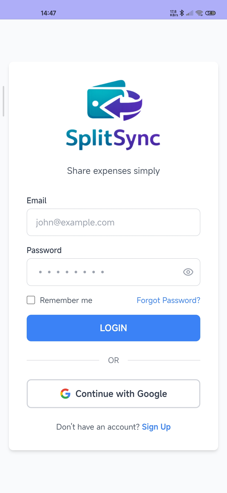 | 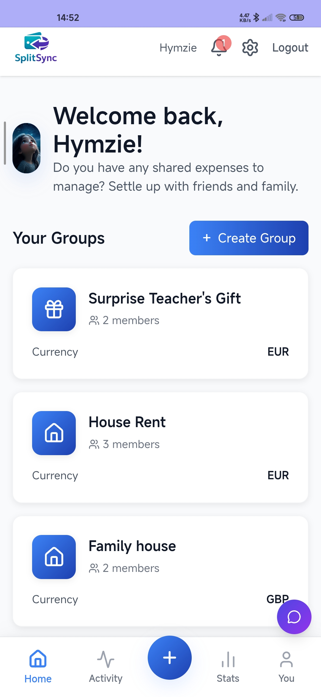 | 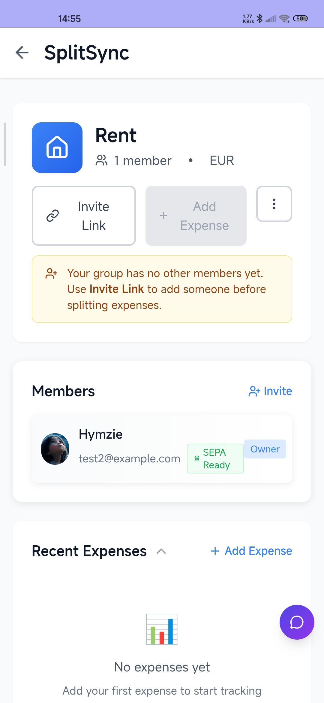 |

| Add Expense | Settle Up | Profile |
|---|---|---|
| 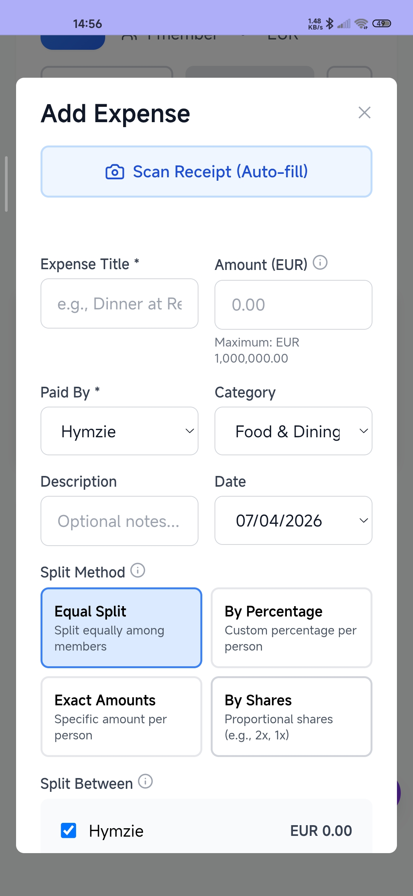 | 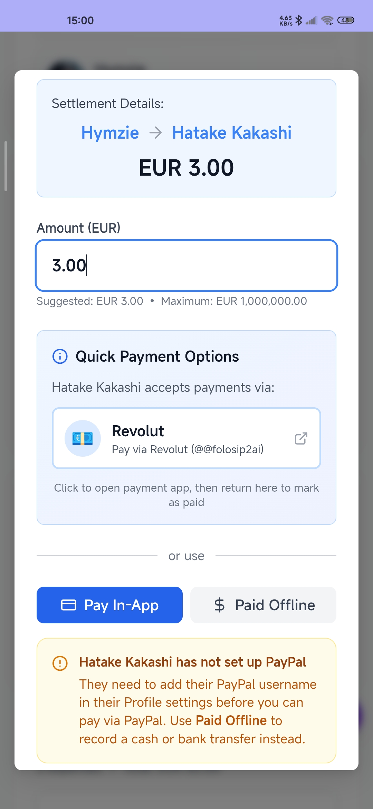 | 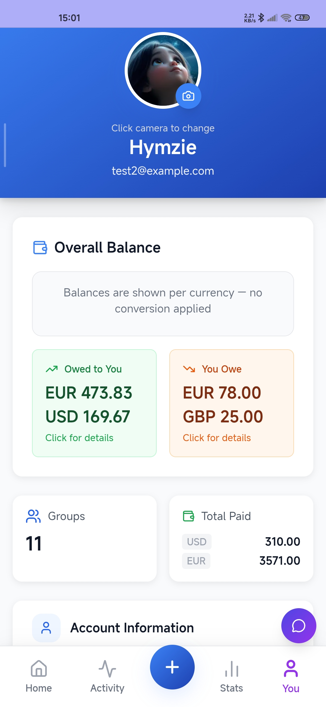 |

| Settings | Analytics | Help and Info |
|---|---|---|
| 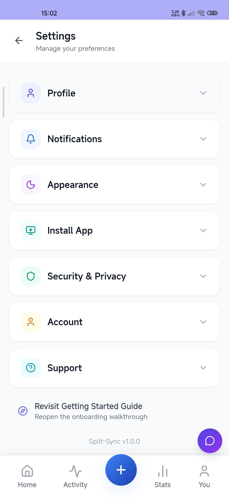 | 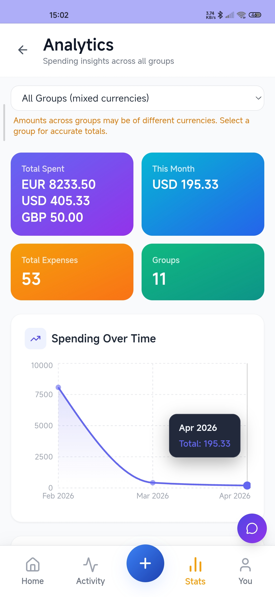 | 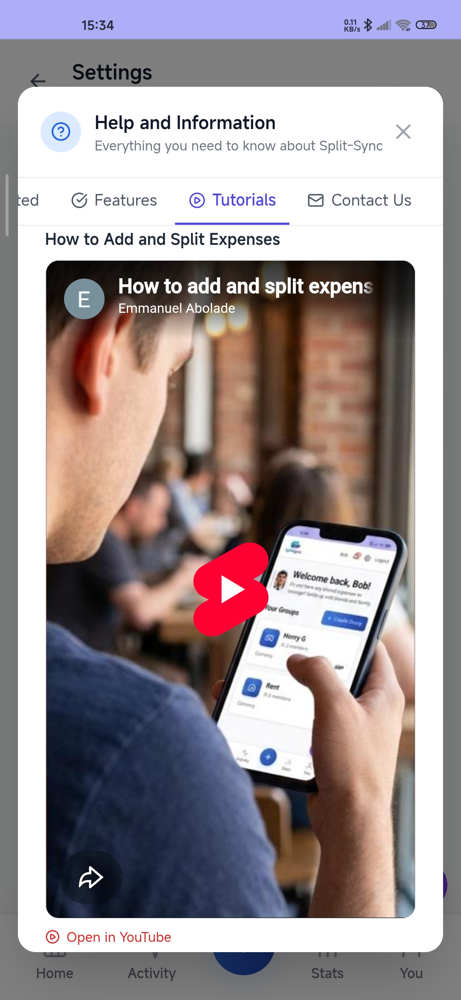 |

### Dark Mode

| Onboarding | Analytics | Activity |
|---|---|---|
| 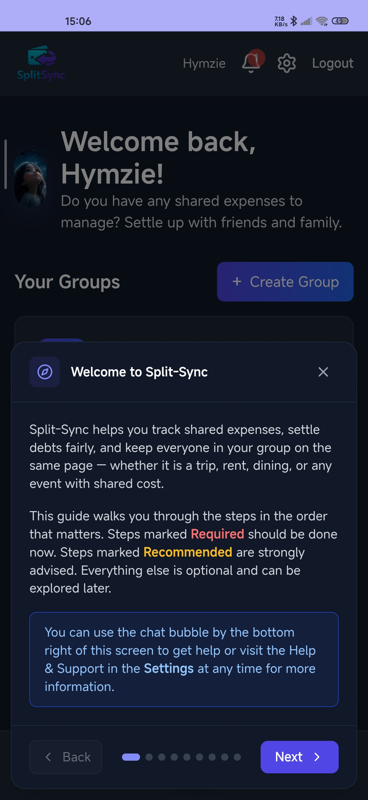 | 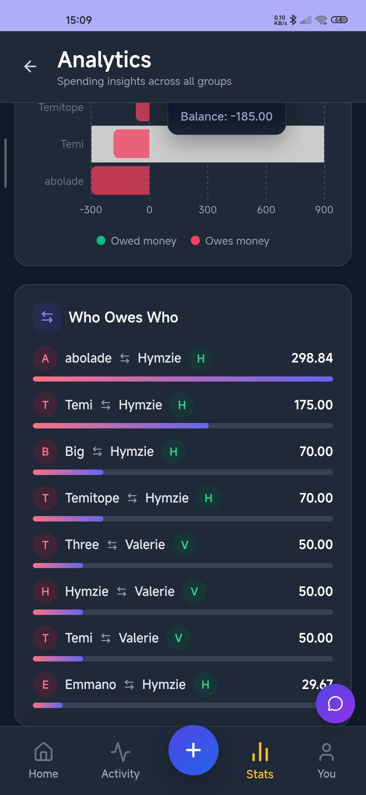 | 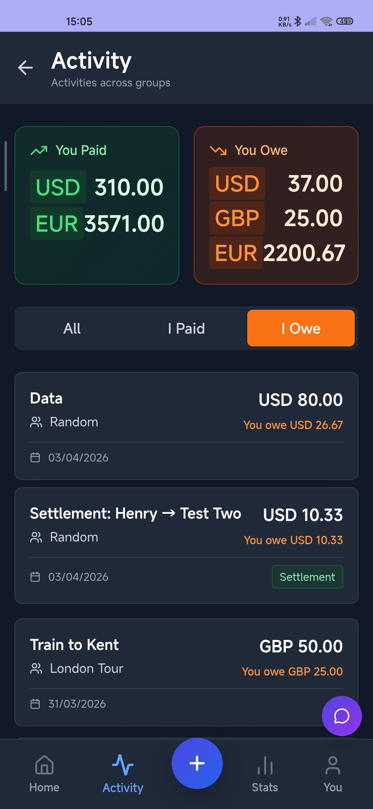 |

| Notification | Personal Dashboard - YOU OWE | Quick Add Expense |
|---|---|---|
| 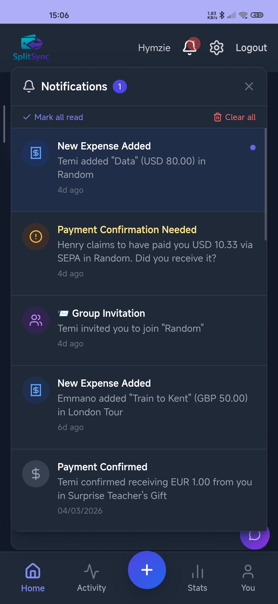 | 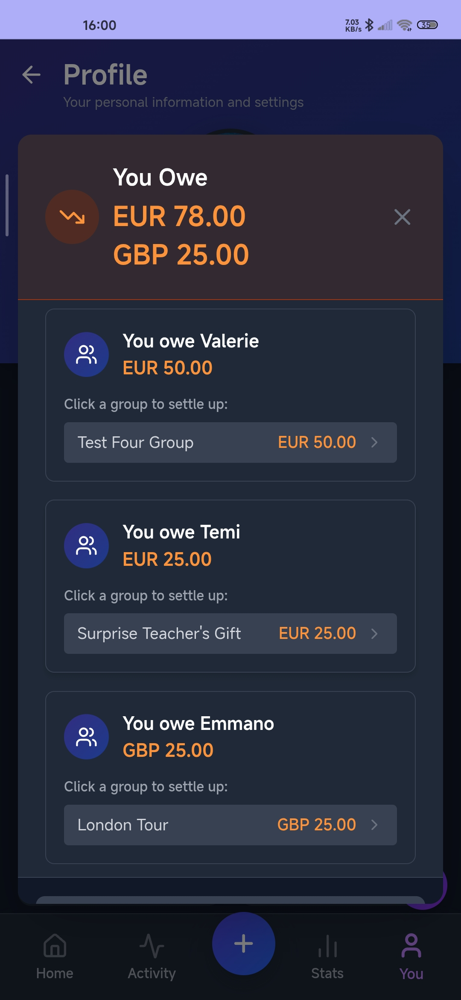 | 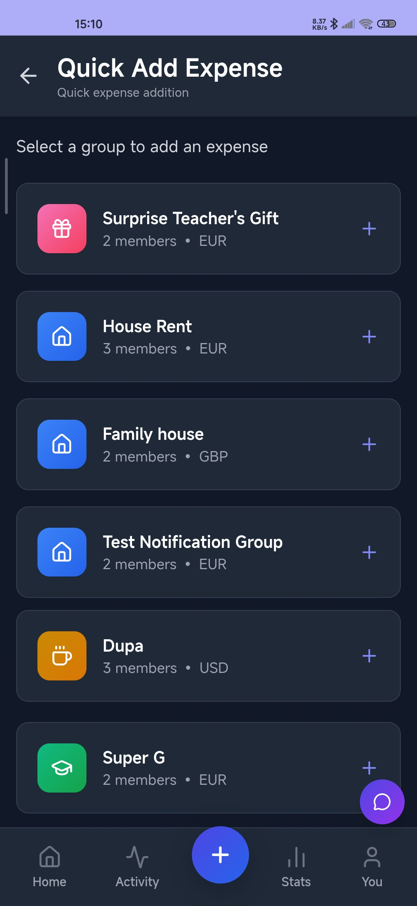 |

| Settle Up Modal | Create Group Modal | Add Member Sync |
|---|---|---|
| 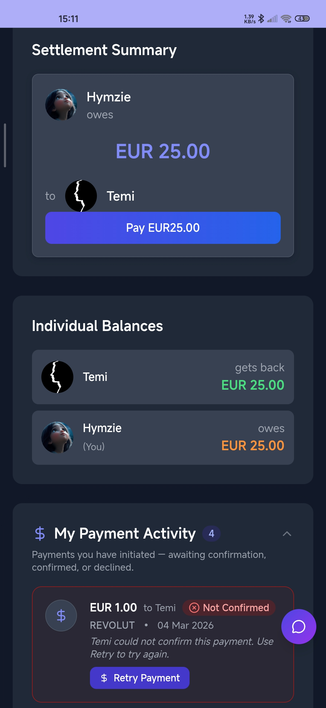 | 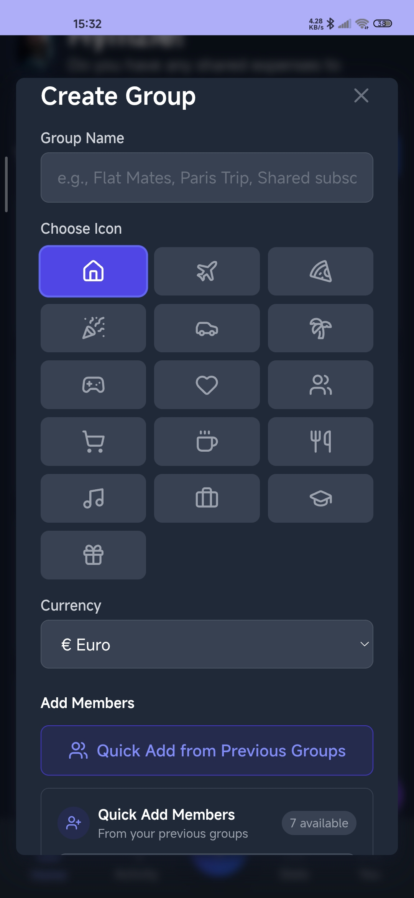 | 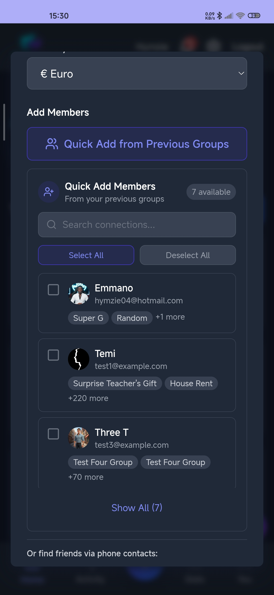 |

## Demo

### Light Mode and Dark Mode


---
<div align="center">

**Built with ❤️ by Emmanuel Abolade**

**Split-Sync** © 2026 - Making expense tracking simple and fair

[⬆ Back to Top](#split-sync-)

</div>
