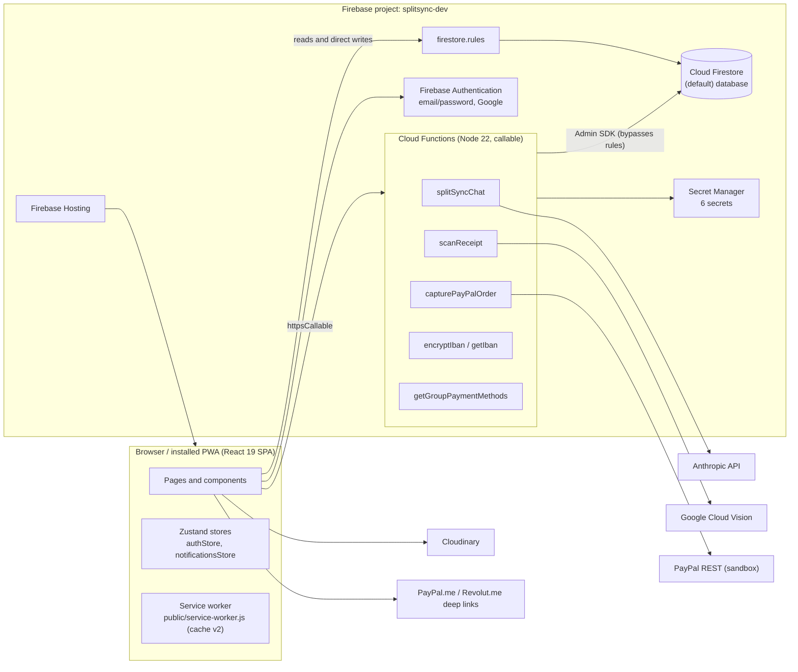
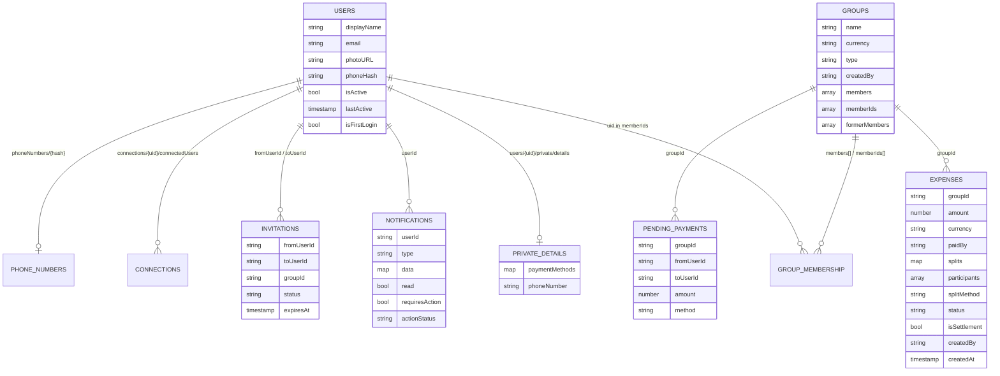

# 00. Codebase Audit: SplitSync Baseline Before the Circles Extension

| | |
|---|---|
| **Document** | `docs/circles/00-codebase-audit.md` |
| **Phase** | 0 (Research and Design). No application code was changed in producing this document. |
| **Audited revision** | `master` at commit `bd82089` (4 November 2026), deployed to `splitsync-dev.web.app` |
| **Method** | Static reading of every source file listed below, plus execution of the three automated test suites (Jest, Cloud Functions unit tests, Firestore rules emulator tests) and a read-only `npm audit` |
| **Purpose** | To record the exact behaviour, structure and quality baseline that the Circles extension must not regress (Brief §2, rule 1; §3, item 1) |

---

## 1. Summary

SplitSync is a single-page Progressive Web Application built with React 19 and Create React App, backed by Firebase Authentication, a single (default) Cloud Firestore database, six callable Cloud Functions (Node 22, 2nd generation) and Firebase Hosting. At the audited revision it comprises 12 page components, 26 shared components, 2 Zustand stores, 1 React context, 3 custom hooks and 13 utility modules: 18,938 lines of non-test client code, plus 4 Cloud Functions modules.

The quality baseline is:

| Measure | Baseline value |
|---|---|
| Jest suites / tests | **58 suites, 1,487 tests, 0 failures** |
| Jest line coverage | **84.25 %** (statements 82.70 %, branches 71.52 %, functions 80.03 %) |
| Cloud Functions unit tests (`node --test`) | **11 tests, 0 failures** |
| Firestore rules tests (emulator) | **31 tests, 0 failures** |

Six findings are material to the design of the Circles extension and are developed in §13:

1. All money-affecting writes (expenses, settlements, soft deletes, pending-payment locks) are currently made **directly from the client**. The Brief (§2, rule 5) requires Cloud Functions for every money write. That rule can be applied to new spaces from the outset, but the existing Expenses space would need a separate, carefully staged migration.
2. The "passkey" is a **device-local WebAuthn assertion**. The credential identifier is kept in `localStorage`, and no server verifies the assertion. It cannot yet serve as the server-trusted step-up authentication the Brief requires (§5).
3. The ledger model is implicit. Settlements are stored as `expenses` documents with `isSettlement: true`, and there is no `spaceId`, no idempotency key and no audit log.
4. None of the following exist yet: a feature-flag mechanism, Firebase App Check, schema validation (for example Zod), rate limiting, a `firestore.indexes.json` file, a named Firestore database, or security headers in `firebase.json`.
5. Several statements in the Brief describe an older version of the codebase (§3 of this document).
6. App-level routing (`src/App.js`) has 0 % test coverage, which is a regression risk for Phase 2 (Hub Home and navigation).

---

## 2. Scope and method

All files under `src/`, `functions/`, `firestore-tests/`, `public/`, and the configuration files `firebase.json`, `.firebaserc`, `firestore.rules` and `package.json` were read. Counts and coverage were obtained by running:

```bash
CI=true npx react-scripts test --watchAll=false --coverage   # Jest
npm run test:functions                                        # node --test functions/*.test.js
npm run test:rules                                            # Firestore emulator, firestore-tests/rules.test.js
npm audit --json            (root and functions/; read-only, no fix applied)
```

Both mockups in `docs/circles/mockups/` were read in full. They are referred to here only where the current code differs from what they assume.

---

## 3. Discrepancies between the Brief and the current codebase

The Brief states that it should be read against the current project, and that stale information should be ignored where necessary. The following statements in the Brief no longer match the code. The current figures in the right-hand column are the baseline for all later phases.

| Brief statement | Current state (verified) | Consequence |
|---|---|---|
| "React 18 + Firebase PWA" (§1) | React **19.2.0**, React Router 7.13.0, Firebase JS SDK 12.6.0 | Documents and code must target React 19. |
| "1,397 passing tests across 52 suites" (§1, §6 item 6) | **1,487 tests across 58 suites** | The regression floor is 1,487 tests, not 1,397. |
| "over 84 % line coverage" | 84.25 % lines | Unchanged in substance; the 84 % floor stands. |
| "WebAuthn passkeys" (§2, rule 1) | Device-local WebAuthn (`src/utils/biometric.js`); credential ID in `localStorage`; no server verification | Step-up authentication requires new server-side verification (§13.2). |
| "Clients read; Functions write ledger entries" (§2, rule 5) | Expenses, settlements, soft deletes and pending-payment locks are written by the client, protected only by Firestore rules | Applies cleanly to new spaces; the existing Expenses space needs a migration plan (§13.1). |
| "PayPal server-side capture" | Present (`capturePayPalOrder`), **sandbox only** (`api-m.sandbox.paypal.com`) | Production use of PayPal is a separate decision. |
| "a previous CSP change in `firebase.json` broke the app" (§5) | `firebase.json` currently contains **no** `headers` block | Any header change starts from zero; preview-channel testing is mandatory. |

The following features exist in the code but are not mentioned in the Brief. They are part of the baseline and must be preserved:

- personal trackers (`groups.type = 'personal'`);
- the membership lifecycle (`formerMembers`, rejoin by invite link only, "(left)" names);
- safe account deletion;
- the owner-only private profile document;
- server-side IBAN encryption;
- the Taskmaster admin panel;
- user suspension;
- the Activity-to-group deep link.

---

## 4. Technology stack (as installed)

| Layer | Technology (installed version) |
|---|---|
| UI framework | React 19.2.0, React DOM 19.2.0, React Router DOM 7.13.0 |
| Build | Create React App (`react-scripts` 5.0.1), Webpack (via CRA), Babel |
| Styling | Tailwind CSS 3.4.17 (`darkMode: 'class'`), PostCSS, Autoprefixer |
| State | Zustand 5.0.8 |
| Icons / charts | `lucide-react` 0.555.0; Recharts 3.7.0 |
| Firebase client | Firebase JS SDK 12.6.0 (Auth, Firestore, Functions) |
| Payments (client) | `@paypal/react-paypal-js` 8.9.2 |
| QR codes | `qrcode` 1.5.4 and `qrcode.react` 4.2.0 (both in use) |
| Cloud Functions | Node 22, `firebase-functions` 7.4.0 (v2 `onCall`), `firebase-admin` 13.x, `@google-cloud/vision` 4.x, `crypto-js` 4.2.0 (legacy IBAN migration only) |
| Testing | Jest (via CRA, `resetMocks: true`), React Testing Library 16, `@firebase/rules-unit-testing` 5.0.2 (in `firestore-tests/`), Node built-in test runner |
| Hosting | Firebase Hosting, SPA rewrite to `/index.html`, project `splitsync-dev` |
| External services | Google Cloud Vision (OCR), Anthropic Claude API (`claude-sonnet-5-5`), PayPal REST (sandbox), Cloudinary (image upload, unsigned preset), Formspree (feedback form) |

---

## 5. Current architecture



**Trust boundary.** The client is untrusted. Firestore security rules are the only control on direct client writes, including all money-affecting writes (§9, §13.1). Cloud Functions run with Admin SDK privileges and bypass the rules, so they must enforce authorisation themselves. All six current functions check `request.auth`, and the group-scoped ones also check membership from server data.

---

## 6. Routes (`src/App.js`)

All authenticated routes except `/taskmaster` are wrapped in `ProtectedLayout`. It renders `BottomNav` (hidden on `/group/*` and `/invite/*`), the floating `SplitSyncChat` assistant and `SessionTimeoutWarning`, and subscribes to notifications. `App` also checks `users/{uid}.isActive` at sign-in, signs out suspended users, and records `lastActive` at most once per day per device.

| Path | Component | Guard | Notes |
|---|---|---|---|
| `/login` | `pages/Login.jsx` | Public (redirects to `/dashboard` if signed in) | Email/password, Google popup, device biometric |
| `/register` | `pages/Register.jsx` | Public | Creates `users/{uid}` |
| `/forgot-password` | `pages/ForgotPassword.jsx` | Public | Detects Google-only accounts |
| `/dashboard` | `pages/Dashboard.jsx` | Authenticated | Current Home (§7) |
| `/activity` | `pages/Activity.jsx` | Authenticated | Cross-group expense feed |
| `/analytics` | `pages/Analytics.jsx` | Authenticated | "Stats" tab |
| `/add` | `pages/QuickAdd.jsx` | Authenticated | Target of the centre "+" button |
| `/profile` | `pages/Profile.jsx` | Authenticated | "You" tab |
| `/settings` | `pages/Settings.jsx` | Authenticated | Opened from the Dashboard gear icon |
| `/group/:groupId` | `pages/GroupDetails.jsx` | Authenticated | Bottom nav hidden |
| `/invite/:groupId` | `pages/JoinGroup.jsx` | Authenticated | Bottom nav hidden. **Defect:** a signed-out visitor is sent to `/login` and, after signing in, lands on `/dashboard`; the invite target is lost |
| `/` and `*` | redirect | | To `/dashboard` or `/login` |
| `/taskmaster` | `pages/Taskmaster.jsx` | Authenticated + `admin` custom claim checked in the page | Not wrapped in `ProtectedLayout`. It is declared after the `*` catch-all; React Router v7 ranks routes by specificity, so it still resolves |

Bottom navigation (`components/BottomNav.jsx`) has five slots, in this order: **Home** (`/dashboard`), **Activity**, **Add** (centre button, `/add`), **Stats** (`/analytics`), **You** (`/profile`). This already matches the Brief (§3, item 6).

---

## 7. Pages (`src/pages/`)

| File | LOC | Responsibilities and features that must be preserved |
|---|---|---|
| `Dashboard.jsx` | 702 | **Current Home.** In render order: invitation notifications, the "Payment method not set" banner, the top bar (logo, which opens Taskmaster for admins, notifications bell, settings gear), welcome with cycling tagline, overview cards (You owe, Owed to you, per currency; Groups count), suggested settlement (largest debt), pending-payment confirmation banner, groups list with per-group balance, Create Group modal, Notifications dropdown and Onboarding wizard. It also self-heals legacy `memberIds` entries. **In Phase 2 this content moves, unchanged, into the Expenses space** |
| `GroupDetails.jsx` | 2,075 | Group header and actions (Invite Link, Add Expense gated on membership and non-solo groups, options menu for CSV/PDF export, Leave, Delete). Also: invite prompt, balance summary, payer and payee pending-payment banners (confirm/decline), pending invitations, section navigation strip, members (with SEPA Ready badges), Settlement Summary with status badges, balances breakdown, My Payment Activity (Active/Dismissed, retry, dismiss, restore), Recent Expenses (settlement styling, archive hint), non-member screen, focus and highlight of an expense from Activity, and Leave/Delete confirmation modals with re-authentication |
| `Activity.jsx` | 388 | Expenses across all groups (chunked `in` queries of at most 30 ids), Active/Archived and All/I Paid/I Owe filters, per-currency You Paid and You Owe cards, "Not involved" label, details modal with group link and edit hand-off |
| `Analytics.jsx` | 674 | Five Recharts charts, a group selector, per-currency totals, former-member names, per-currency Who Owes Who rows |
| `QuickAdd.jsx` | 213 | Group picker for adding an expense; shared groups without another member are disabled; personal trackers are allowed |
| `Profile.jsx` | 925 | Per-currency Owed/Owe cards with a breakdown modal, photo upload (Cloudinary), payment settings behind biometric or password (private document plus server IBAN encryption), phone number for Contact Sync (private) |
| `Settings.jsx` | 798 | Sections: Profile (name sync across groups), Notifications, Appearance (dark mode), Install App, Security & Privacy (biometric, auto-logout timer), Account (log out, safe account deletion), Support (help hub, QR share, Getting Started) |
| `JoinGroup.jsx` | 285 | Invite-link landing; personal trackers refused; rejoin clears `formerMembers` |
| `Login.jsx` / `Register.jsx` / `ForgotPassword.jsx` | 320 / 215 / 238 | Authentication flows; a suspended-account message on Login |
| `Taskmaster.jsx` | 942 | Admin panel with System Health, Platform Growth, Users (suspend), Groups, Financial Oversight, Content Moderation and Broadcast. Excluded from coverage |

---

## 8. Components, stores, hooks and utilities

### 8.1 Shared components (`src/components/`)

| Component | Purpose |
|---|---|
| `AddExpenseModal.jsx` (1,118 LOC) | Add and edit expenses; four split methods; inline calculator; receipt scan; personal-tracker mode; membership guard; blocked while an incoming payment awaits confirmation |
| `SettleUpModal.jsx` (1,217) | Payment flow: PayPal and Revolut links with clipboard copy, QR scan-to-pay, SEPA details, Mark as Paid, pending-payment lock, PayPal sandbox and SEPA demo panel |
| `ExpenseDetailsModal.jsx` (571) | Expense details; creator-only edit, archive, restore and soft delete; lock after a later settlement; group link |
| `SepaPaymentModal.jsx` (417) | SEPA demo simulation |
| `CreateGroupModal.jsx` (450) | Shared group or personal tracker; duplicate-name suggestions; Quick Add and Contact Sync invitations |
| `NotificationsDropdown.jsx` (280), `InvitationNotification.jsx` (225) | Bell dropdown with actions; invitation banners |
| `OnboardingWizard.jsx` (438), `InfoHubModal.jsx` (338) | Getting Started wizard; help hub with tutorial videos |
| `SplitSyncChat.jsx` (311) | Floating AI assistant; sends shared and personal group counts as context |
| `ShareInviteModal.jsx`, `QRCodeModal.jsx`, `QRCodeCanvas.jsx` | Invite sharing and QR codes |
| `ReceiptScanner.jsx` (355), `CloudinaryUpload.jsx` (286) | OCR receipt capture; image upload |
| `QuickAddMembers.jsx`, `ContactSyncButton.jsx` | Member discovery from previous groups and from phone contacts |
| `BalanceBreakdownModal.jsx`, `PaymentInfoModal.jsx` | Profile balance breakdown; payment information |
| `BottomNav.jsx`, `SessionTimeoutWarning.jsx`, `DarkModeToggle.jsx`, `IconSelector.jsx`, `PasswordStrength.jsx`, `Tooltip.jsx` | Shell and form primitives |
| `ProfilePhotoUpload.jsx` | **Not imported anywhere** (see §12) |

### 8.2 State, context and hooks

| Module | Exports / role |
|---|---|
| `stores/authStore.js` | `useAuthStore`: `user`, `isAuthenticated`, `loading`, `setUser`, `updateUserPhoto`, `updateUserDisplayName`, `logout` (persisted) |
| `stores/notificationsStore.js` | `useNotificationsStore` (real-time subscription, mark read, clear) plus the payment-confirmation functions `createNotification`, `recordPaymentSent`, `confirmPaymentReceived` (writes the settlement expense) and `declinePaymentReceived` |
| `contexts/DarkModeContext.jsx` | `DarkModeProvider`, `useDarkMode` (class-based Tailwind dark mode) |
| `hooks/useSessionTimeout.js` | Inactivity timer (configurable 5 to 30 minutes, or off), warning, auto-logout |
| `hooks/useFormerMemberNames.js` | Profile lookup for former members |
| `hooks/useKeyboardAware.js` | **Not used by any component** (see §12) |

### 8.3 Utilities (`src/utils/`)

| Module | Role |
|---|---|
| `balanceCalculator.js` | `calculateBalances` (per group; removed expenses excluded), `calculateSettlements` (greedy minimum-transfer), `getUserBalanceSummary`, `groupByCurrency` (unused) |
| `memberDirectory.js` | Membership by `members`, former-member names, personal-tracker detection |
| `accountDeletion.js` | Balance-guarded account deletion (leave groups, transfer ownership, keep shared history, erase private data) |
| `privateProfile.js`, `ibanService.js` | Owner-only private profile; server-side IBAN encryption and decryption |
| `invitationSystem.js`, `userConnectionsManager.js`, `contactSyncManager.js` | Invitations (7-day expiry), connections graph for Quick Add, SHA-256 phone-hash discovery |
| `paymentLinks.js`, `sepaPayment.js`, `encryption.js` | PayPal.me and Revolut links, SEPA demo helpers, IBAN validation and masking |
| `biometric.js` | Device-local WebAuthn register and assert (§13.2) |
| `adminStats.js` | Taskmaster calculations |

---

## 9. Data model: Cloud Firestore `(default)` database

There is one database. No named database and no `firestore.indexes.json` exist. The application's queries use only automatic single-field indexes.



| Collection | Key facts | Written by (client unless stated) |
|---|---|---|
| `users/{uid}` | Public profile; must never contain `paymentMethods` or `phoneNumber` (enforced by the rules) | Register, Login, Settings, Profile, App (`lastActive`); admins may change only `isActive` |
| `users/{uid}/private/details` | `paymentMethods` (with `encryptedIBAN` in v2 AES-256-GCM format), `phoneNumber`; owner only | `privateProfile.js`; Functions (legacy migration) |
| `groups/{id}` | `type` `'shared'` or `'personal'`; `members` is the source of truth; `memberIds` is used for queries and rules; `formerMembers` holds name snapshots | CreateGroupModal, JoinGroup, invitationSystem, GroupDetails, Settings, accountDeletion, Dashboard self-heal; admins may rename |
| `expenses/{id}` | **This is the de facto ledger.** It holds expenses and settlements (`isSettlement: true`, payer = debtor, single split to the creditor). `status` is `active`, `archived` or `deleted` (soft delete). No `spaceId`, no idempotency key | AddExpenseModal, ExpenseDetailsModal, SettleUpModal, `notificationsStore.confirmPaymentReceived`, GroupDetails (group-deletion batch), accountDeletion; admins may soft-delete |
| `pendingPayments/{groupId_from_to}` | Lock preventing a duplicate payment while confirmation is pending | SettleUpModal, GroupDetails, AddExpenseModal (auto-cancel) |
| `notifications/{id}` | Includes the cross-user payment confirmation flow (`payment_confirmation_needed`, `payment_log`) | notificationsStore, GroupDetails, Taskmaster broadcast |
| `invitations/{id}` | 7-day expiry | invitationSystem; admins delete expired ones |
| `phoneNumbers/{hash}`, `connections/{uid}/connectedUsers/{id}` | Contact discovery; Quick Add graph | contactSyncManager, userConnectionsManager |

**Currency and space separation today.** Each group has exactly one currency. Balances are computed per group (`calculateBalances`) and displayed per currency, with no conversion, on the Dashboard, Profile, Activity and Analytics. Settlement suggestions are computed within one group. This already satisfies the spirit of Brief §2, rule 2, for the single existing space. The `spaceId` dimension does not yet exist.

---

## 10. Security controls in place

### 10.1 Firestore security rules (`firestore.rules`; deployed; 31 emulator tests in `firestore-tests/rules.test.js`)

- **Default:** the final `match /{document=**}` denies everything.
- **`users`:** read by any authenticated user. Owners write their own document, and may never add or change `paymentMethods` or `phoneNumber`. Admins may change only `isActive`.
- **`users/{uid}/private/{doc}`:** owner only (admins excluded).
- **`groups`:**
  - Read by any authenticated user (needed for invite previews).
  - Create only as `createdBy == uid` with `memberIds == [uid]`.
  - Update by non-suspended members, or by `isSelfJoin()`: a non-member may add only themselves, and never to a personal tracker.
  - Admins may only rename.
  - Delete by the owner (or a sole remaining member).
- **`expenses`:**
  - Read by group members or admins.
  - Create, update and delete only by current, non-suspended members.
  - `createdBy` must equal the requester when present, and `groupId` is immutable.
  - Admins may only soft-delete.
- **`notifications`:**
  - Read and delete by the owner only.
  - Create by any authenticated user.
  - Update by the owner, or by the payer or payee named in `data`; amount and parties are immutable.
- **`invitations`:** read by sender, recipient or admin; delete by the sender or an admin.
- **`pendingPayments`:**
  - Read by payer or payee. The read rule also allows `resource == null`.
  - Create and update only by the payer.
  - Delete by the payer or the payee.

### 10.2 Cloud Functions (`functions/index.js`)

| Function | Auth / authorisation | Secrets | Purpose |
|---|---|---|---|
| `splitSyncChat` | `request.auth`; messages at most 4,000 characters; last 20 kept | `ANTHROPIC_API_KEY` | AI assistant (`claude-sonnet-5-5`, low effort, prompt caching); prompt in `functions/assistantPrompt.js` |
| `scanReceipt` | `request.auth` | `GOOGLE_VISION_API_KEY` | OCR |
| `capturePayPalOrder` | `request.auth` | `PAYPAL_CLIENT_ID`, `PAYPAL_CLIENT_SECRET` | Server-side PayPal capture (sandbox) |
| `encryptIban` | `request.auth`; IBAN format check | `IBAN_ENCRYPTION_KEY` | AES-256-GCM encryption |
| `getIban` | `request.auth`; owner, or a member of the same group (server-side check) | `IBAN_ENCRYPTION_KEY`, `LEGACY_IBAN_KEY` | Decrypt and migrate legacy formats |
| `getGroupPaymentMethods` | `request.auth`; caller must be in `members` | `IBAN_ENCRYPTION_KEY` | Members' payment options (never IBANs) |

Input validation is hand-written (type and length checks). There is no schema library, no App Check enforcement and no rate limiting.

### 10.3 Other controls

- **Secrets:** six secrets in Secret Manager. None are in `REACT_APP_*` variables, and the production bundle was verified to contain no key value.
- **Client-side protections:** session timeout; suspension enforced at sign-in and in the rules; device biometric before viewing payment settings and before deleting a group.
- **XSS:** React escaping throughout; no `dangerouslySetInnerHTML`. The one `document.write` (`GroupDetails.jsx`, CSV/PDF print export) writes into a new window from group data. It should be reviewed for escaping of user-supplied names and titles before the Circles work extends exports (noted, not changed).

---

## 11. Test, coverage and dependency baseline

### 11.1 Totals (run on 4 November 2026)

| Suite | Result |
|---|---|
| Jest | 58 suites, **1,487 passed**, 0 failed |
| Coverage | Statements 82.70 % (3,571/4,318), Branches 71.52 % (2,281/3,189), Functions 80.03 % (854/1,067), **Lines 84.25 % (3,237/3,842)** |
| Coverage exclusions (`package.json`) | `Taskmaster.jsx`, `CloudinaryUpload.jsx`, `ContactSyncButton.jsx`, `ReceiptScanner.jsx` |
| Lowest line coverage (included files) | `App.js` 0 %, `index.js` 0 %, `serviceWorkerRegistration.js` 0 %, `reportWebVitals.js` 0 %, `ExpenseDetailsModal.jsx` 50 %, `Dashboard.jsx` 70.3 %, `Profile.jsx` 73.6 %, `CreateGroupModal.jsx` 74.0 %, `AddExpenseModal.jsx` 75 % |
| Cloud Functions (`npm run test:functions`) | 11 passed (`iban.test.js`, `privateData.test.js`) |
| Firestore rules (`npm run test:rules`) | 31 passed (requires Java and the emulator) |

### 11.2 Jest suites (test count per suite)

| Suite | Tests | Suite | Tests |
|---|---|---|---|
| `components/AddExpenseModal.test.jsx` | 53 | `pages/GroupDetails.extra.test.jsx` | 47 |
| `components/BalanceBreakdownModal.test.jsx` | 13 | `pages/GroupDetails.test.jsx` | 40 |
| `components/BottomNav.test.jsx` | 30 | `pages/GroupDetails_new.test.jsx` | 20 |
| `components/CreateGroupModal.test.jsx` | 33 | `pages/GroupDetails.extended.test.jsx` | 22 |
| `components/DarkModeToggle.test.jsx` | 14 | `pages/JoinGroup.test.jsx` | 27 |
| `components/ExpenseDetailsModal.test.jsx` | 37 | `pages/Login.test.jsx` | 32 |
| `components/IconSelector.test.jsx` | 9 | `pages/Profile.test.jsx` | 40 |
| `components/InfoHubModal.test.jsx` | 11 | `pages/Profile_extra.test.jsx` | 17 |
| `components/InvitationNotification.test.jsx` | 34 | `pages/QuickAdd.test.jsx` | 15 |
| `components/NotificationsDropdown.test.jsx` | 29 | `pages/Register.test.jsx` | 31 |
| `components/OnboardingWizard.test.jsx` | 28 | `pages/Settings.test.jsx` | 33 |
| `components/PasswordStrength.test.jsx` | 37 | `pages/Settings_extra.test.jsx` | 16 |
| `components/PaymentInfoModal.test.jsx` | 14 | `stores/authStore.test.js` | 25 |
| `components/ProfilePhotoUpload.test.jsx` | 12 | `stores/notificationsStore.test.js` | 30 |
| `components/QRCodeCanvas.test.jsx` | 23 | `stores/notificationsStore_helpers.test.js` | 35 |
| `components/QRCodeModal.test.jsx` | 23 | `utils/accountDeletion.test.js` | 6 |
| `components/QuickAddMembers.test.jsx` | 20 | `utils/adminStats.test.js` | 7 |
| `components/SepaPaymentModal.test.jsx` | 24 | `utils/balanceCalculator.test.js` | 14 |
| `components/SessionTimeoutWarning.test.jsx` | 10 | `utils/biometric.test.js` | 35 |
| `components/SettleUpModal.test.jsx` | 61 | `utils/contactSyncManager.test.js` | 32 |
| `components/ShareInviteModal.test.jsx` | 24 | `utils/encryption.test.js` | 22 |
| `components/SplitSyncChat.test.jsx` | 25 | `utils/ibanService.test.js` | 4 |
| `components/Tooltip.test.jsx` | 21 | `utils/invitationSystem.test.js` | 48 |
| `contexts/DarkModeContext.test.jsx` | 19 | `utils/memberDirectory.test.js` | 6 |
| `hooks/useKeyboardAware.test.js` | 14 | `utils/paymentLinks.test.js` | 44 |
| `hooks/useSessionTimeout.test.js` | 25 | `utils/privateProfile.test.js` | 6 |
| `pages/Activity.test.jsx` | 25 | `utils/sepaPayment.test.js` | 43 |
| `pages/Analytics.test.jsx` | 42 | `utils/userConnectionsManager.test.js` | 29 |
| `pages/Dashboard.test.jsx` | 26 | `pages/ForgotPassword.test.jsx` | 25 |

**Testing conventions that later phases must follow:**

- CRA runs Jest with `resetMocks: true`, so module-level `jest.fn(impl)` implementations are reset before each test.
- Page tests mock `react-router-dom` per file. Any new router hook must be added to every page mock.
- On Windows, `firebase emulators:exec` can leave the Firestore emulator process running on port 8080.

### 11.3 Dependency audit (read-only; no fix applied, per Brief §5)

| Package set | Low | Moderate | High | Critical | Total |
|---|---|---|---|---|---|
| Root (`package.json`) | 18 | 15 | 35 | 4 | 72 |
| `functions/` | 5 | 21 | 10 | 2 | 38 |

**Interpretation:**

- **Root:**
  - Most root findings are transitive dependencies of the `react-scripts` 5 build toolchain (for example webpack-dev-server, svgo, workbox-build).
  - CRA puts these under `dependencies`, so `--omit=dev` does not filter them. They affect the build and development server, not the deployed bundle.
  - Two direct dependencies are flagged: `postcss`, where the reported fix requires a breaking `react-scripts` change, and `react-router-dom` 7.13.0, where a non-breaking fix within 7.x is reported.
  - Most React Router advisories concern server-rendering and framework mode, which this SPA does not use. One advisory concerns an open redirect via `<Link>` and is relevant in principle.
- **Functions:** the critical items are `protobufjs` and `websocket-driver`, both transitive through the Google Cloud and Firebase Admin libraries.

A dependency-upgrade task is recommended as a separate, reviewed change (§13.6). Version pinning is not in place: all dependencies use caret ranges.

---

## 12. Unused code and duplication (reported only; nothing deleted)

| Item | Evidence |
|---|---|
| `components/ProfilePhotoUpload.jsx` (and its 12 tests) | Not imported by any component; `Profile.jsx` uses `CloudinaryUpload` |
| `hooks/useKeyboardAware.js` (and its 14 tests) | Not imported by any component |
| `tesseract.js` dependency | Never imported (OCR moved to Cloud Vision) |
| `crypto-js` in the **root** `package.json` | No client import since IBAN encryption moved server-side (still needed in `functions/`) |
| `balanceCalculator.groupByCurrency`, `sepaPayment.validateIBAN` (duplicates `encryption.validateIBAN`) | No non-test callers |
| `invitationSystem.cleanupExpiredInvitations`, `getInvitationCount`; `paymentLinks.formatBankTransferInfo`; `biometric.enableBiometric`; `userConnectionsManager.getConnectionDetails`, `removeConnection`, `updateConnectionOnLeaveGroup`, `getSuggestedConnections` | No non-test callers. `updateConnectionOnLeaveGroup` being unused means leaving a group does not update the connections graph |
| Notification types `payment_confirmed`, `payment_declined`, `settlement` | Styled in `NotificationsDropdown.jsx` but never created |
| `pages/GroupDetails_new.test.jsx` | A fourth GroupDetails suite overlapping the other three |
| `public/favicon(1).ico`, `public/logo192(1).png`, `public/logo512(1).png`, `public/test-results.txt` | Duplicate or stray files |
| `firebase-functions-test` (functions devDependency) | Not used by any functions test |
| `docs/doxygen/html/` | Generated documentation predating the November 2026 changes (stale) |

---

## 13. Findings that constrain the Circles design

### 13.1 Money-affecting writes are client-side today

Brief §2, rule 5 requires every money-affecting write to happen in Cloud Functions. Today these writes are made directly by the client and protected only by Firestore rules:

- the creation of expenses and settlements (`AddExpenseModal`, `SettleUpModal`, `notificationsStore.confirmPaymentReceived`);
- soft deletes (`ExpenseDetailsModal`);
- pending-payment locks.

**Implication:** New spaces (Circles, Loans, Aid, Events, Refunds) can and should be Function-only from the first commit. Moving the existing Expenses space behind Functions would change the most heavily tested code paths (the `AddExpenseModal`, `SettleUpModal` and `GroupDetails` suites, about 280 tests). It therefore needs explicit approval, under rule 1, as a separately staged migration. It should not be a side effect of Phase 1.

### 13.2 Step-up authentication is not server-verifiable yet

`src/utils/biometric.js` calls `navigator.credentials.create` and `navigator.credentials.get` with a random challenge generated in the browser, and stores the credential identifier in `localStorage`. No public key is stored on the server and no assertion is verified there. It is therefore a local user-presence check, not proof to the server.

**Implication:** The Brief's requirement for a fresh passkey check before paying, lending, accepting loan terms, approving spends or accepting refunds needs server-issued challenges and server-side assertion verification. That means a new Function pair and a stored credential public key. Until then, any "Confirm with passkey" step is advisory only.

### 13.3 The ledger is implicit

There is no separate ledger collection: `expenses` doubles as the ledger. Corrections are made by editing documents (creator edits) or by status changes (`archived`, `deleted`), not by reversing entries. There is no `spaceId`, no idempotency key (beyond the `pendingPayments` lock), and no audit log of privileged actions.

**Implication:** The Phase 1 "`spaceId` on ledger entries" migration can treat the absence of `spaceId` as `'expenses'` (read-time default). That avoids rewriting existing documents and is backwards-compatible with every current query and rule. Refunds (Phase 3) must be modelled as new linked entries, never as edits.

### 13.4 Infrastructure absent today

The following do not exist yet and must be introduced as new, tested components:

- feature flags;
- Firebase App Check;
- server-side schema validation;
- rate limiting;
- an audit log;
- a `firestore.indexes.json` file;
- a named `circles` database, together with a matching multi-database `firestore` configuration in `firebase.json`, a second rules file and its own emulator tests;
- security headers or a Content Security Policy.

### 13.5 Navigation

Two facts favour the Brief's Phase 2 plan:

- The bottom navigation already has the five slots the Brief specifies.
- The current Home (`Dashboard.jsx`) is a self-contained page, so it can be mounted unchanged as the Expenses space.

Two regression risks need addressing before the routing change:

- `App.js` has no tests.
- `Dashboard.test.jsx` (26 tests) and `BottomNav.test.jsx` (30 tests) assert on the current `/dashboard` route and labels.

The invite-link redirect defect (§6) should be fixed while routing is being changed, subject to approval.

### 13.6a PayPal Checkout has no payee

In `SettleUpModal.jsx`, `actions.order.create` sets no `payee` (the `payee.email_address` block is commented out), and the order is captured by `capturePayPalOrder` using SplitSync's own PayPal REST credentials. In sandbox this is harmless. In a live environment, however, the funds would be credited to **SplitSync's merchant account rather than to the creditor**. SplitSync would then be receiving and holding funds on behalf of users: the custody model the Brief excludes (§1).

**Implication:** PayPal Checkout must either set the creditor as payee or remain a sandbox demonstration. Real-money PayPal payments should use the existing PayPal.me deep link. `11-payments.md` develops this.

### 13.6 Recommended pre-work (for approval; not performed)

1. Add an `App.js` routing test suite before Phase 2.
2. Upgrade `react-router-dom` within 7.x (non-breaking, per `npm audit`) as a separate reviewed change, and pin versions.
3. Decide whether the Expenses space migrates to Function-only writes (§13.1). This decision affects `10-database-design.md` and `11-payments.md`.
4. Decide whether server-verified WebAuthn is in scope for Phase 1 or a later phase (§13.2). Step-up authentication in Circles, Loans and Events depends on it.

---

## 14. Regression checklist (features that must keep working)

Each Brief §2, rule 1 feature is mapped below to the code and tests that currently protect it. Every later phase must keep these green.

| Feature | Primary files | Guarding tests |
|---|---|---|
| Authentication (email, Google), suspension | `App.js`, `Login.jsx`, `Register.jsx`, `ForgotPassword.jsx`, `authStore.js` | Login, Register, ForgotPassword, authStore suites; rules tests (suspension) |
| WebAuthn (device-local) | `biometric.js`, `Login.jsx`, `Settings.jsx`, `Profile.jsx`, `GroupDetails.jsx` | `biometric.test.js` |
| Session timeout | `useSessionTimeout.js`, `SessionTimeoutWarning.jsx` | Both suites |
| Groups, membership lifecycle, personal trackers | `CreateGroupModal.jsx`, `GroupDetails.jsx`, `JoinGroup.jsx`, `memberDirectory.js`, `invitationSystem.js` | GroupDetails (4 suites), JoinGroup, CreateGroupModal, memberDirectory, invitationSystem; rules tests |
| All split methods | `AddExpenseModal.jsx`, `balanceCalculator.js` | AddExpenseModal, balanceCalculator |
| OCR | `ReceiptScanner.jsx`, `scanReceipt` | None (component excluded from coverage) |
| AI assistant | `SplitSyncChat.jsx`, `splitSyncChat`, `assistantPrompt.js` | SplitSyncChat suite |
| PayPal server capture, Revolut, SEPA | `SettleUpModal.jsx`, `SepaPaymentModal.jsx`, `paymentLinks.js`, `capturePayPalOrder` | SettleUpModal, SepaPaymentModal, paymentLinks, sepaPayment |
| Archive / soft delete, edit lock | `ExpenseDetailsModal.jsx` | ExpenseDetailsModal suite (50 % line coverage, a weak point) |
| Pending payment locks, confirm / decline | `SettleUpModal.jsx`, `GroupDetails.jsx`, `notificationsStore.js` | SettleUpModal, notificationsStore (2 suites); rules tests |
| Analytics | `Analytics.jsx` | Analytics suite |
| Notifications, invitations | `notificationsStore.js`, `NotificationsDropdown.jsx`, `InvitationNotification.jsx` | Corresponding suites |
| Offline / PWA | `public/service-worker.js` (cache `v2`, network-first navigation), `serviceWorkerRegistration.js`, `manifest.json` | None (0 % coverage) |
| Dark mode | `DarkModeContext.jsx`, `DarkModeToggle.jsx`, Tailwind `dark:` classes | DarkModeContext, DarkModeToggle |
| Profile, private data, IBAN protection | `Profile.jsx`, `privateProfile.js`, `ibanService.js`, `encryptIban` / `getIban` / `getGroupPaymentMethods` | Profile (2 suites), privateProfile, ibanService; functions tests; rules tests |
| Settings, safe account deletion | `Settings.jsx`, `accountDeletion.js` | Settings (2 suites), accountDeletion |
| Activity, deep link to group | `Activity.jsx`, `GroupDetails.jsx` | Activity suite, GroupDetails.extra |
| Admin (Taskmaster) | `Taskmaster.jsx`, `adminStats.js` | `adminStats.test.js` (page excluded from coverage) |

---

## 15. Decisions agreed with the product owner (4 November 2026)

| # | Question | Decision |
|---|---|---|
| D1 | Existing money writes (§13.1) | **New spaces are Function-only from their first commit.** The Expenses space keeps client writes for ordinary expenses for now. **Settlement recording moves to Cloud Functions early, as its own phase (Phase 1B).** Today any member can record a settlement claiming that someone else paid, and settlements are where idempotency and audit matter most. Ordinary expense writes migrate last (Phase 10), once the shared ledger helpers are proven. |
| D2 | Step-up authentication (§13.2) | **Server-verified step-up is built in Phase 1.** The primary method is WebAuthn with server-issued, single-use challenges and server-side assertion verification against a stored public key. The fallback is recent re-authentication, verified by the Function from the ID token's `auth_time` claim. The server, never the client, decides whether step-up has been satisfied. |
| D3 | Baseline figures (§3) | All Phase 0 documents use the verified baseline: React 19.2, 58 suites, 1,487 tests, 84.25 % lines. |
| D4 | Pre-work (§13.6) | A short **Phase 0.5** precedes Phase 2: `App.js` routing tests, the invite-link redirect fix, and the non-breaking `react-router-dom` 7.x upgrade with pinned versions. |

Further design principles agreed at the same time:

- **Feature flags are enforced on the server.** A Function for a disabled space rejects the call; the UI hides it as well.
- **App Check is introduced in monitoring mode first,** then enforced.
- **Cross-database consistency.** The `circles` database is retained for isolation. No operation may require an atomic write across both databases, so anything spanning them (for example the trust score) is designed to be eventually consistent.
- **SplitSync coordinates and records; it never holds funds.**

No external sources are cited in this document: every statement is derived from the repository itself. The Harvard-style reference list required by the Brief begins with `01-business-case.md` and is collected in `references.md`.
