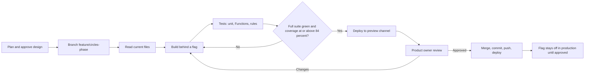

# 03. Frameworks and Methodology

| | |
|---|---|
| **Document** | `docs/circles/03-frameworks-and-methodology.md` |
| **Phase** | 0 (Research and Design) |
| **Depends on** | `02-requirements.md` |

This document states how the extension will be developed, secured and designed, and why each framework was chosen.

---

## 1. Development methodology

### 1.1 Approach: incremental delivery in Scrum-style phases

The work follows the values of the Agile Manifesto (Beck *et al.*, 2001), especially working software and responding to change, and borrows its cadence from Scrum (Schwaber and Sutherland, 2020). Full Scrum is not adopted, because there is a single developer working with a single product owner. The parts that are used:

| Scrum element | Adaptation for this project |
|---|---|
| Product backlog | User stories in `08-user-stories.md`, prioritised with MoSCoW |
| Sprint | One **phase** (`14-implementation-plan.md`), sized to deliver one shippable, flag-protected increment |
| Sprint goal | The phase scope in Brief §6 |
| Definition of Done | §1.3 below |
| Sprint review | The product owner reviews the preview-channel deployment and every diff before merge (Brief §7) |
| Retrospective | A short "lessons and dead code" note at the end of each phase (Brief §6, item 11) |

A phase-gated plan is preferred over continuous release because of the risk profile. The product is live, handles real money obligations, and must not regress (Brief §2, rule 1).

### 1.2 Phase loop

### 1.3 Definition of Done (every phase)

1. The requirements in scope have passing acceptance tests.
2. The full Jest suite passes, with **no fewer than the 1,487 baseline tests** plus the new ones.
3. Line coverage is ≥ 84 % overall and ≥ 90 % for money and rules code (NFR-MNT-02).
4. The Firestore rules tests pass in the emulator for every database touched.
5. The Cloud Functions tests pass.
6. Lint is clean for the changed files; no new warnings.
7. Light and dark modes, keyboard access and reduced motion have been checked.
8. The preview channel has been deployed and reviewed.
9. Documentation is updated (`projectdoc.md`, the assistant prompt, this documentation set where the design changed).
10. `npm audit` has been run and its results reported; dead code noticed is listed.

### 1.4 Requirements engineering techniques

- **Use cases** in the "fully dressed" form (Cockburn, 2001) for the main flows (`07-use-cases.md`).
- **User stories** with acceptance criteria in Given/When/Then form (Cohn, 2004; North, 2006) (`08-user-stories.md`).
- **MoSCoW prioritisation** (Clegg and Barker, 1994).
- **ISO/IEC 25010** quality characteristics to structure the non-functional requirements (ISO/IEC, 2011).

---

## 2. Security frameworks

### 2.1 OWASP Application Security Verification Standard (ASVS) 4.0

ASVS provides testable security requirements grouped by chapter (OWASP Foundation, 2019). **Level 2** is targeted: the level ASVS recommends for applications that handle sensitive data or transactions. The mapping to this design is in `12-security-and-threat-model.md` §4. The chapters most relevant here are:

- V2 Authentication: step-up re-authentication (FR-CORE-08).
- V3 Session Management.
- V4 Access Control: server-derived roles (NFR-SEC-02).
- V5 Validation: schema validation (FR-CORE-11).
- V7 Error Handling and Logging: the audit log (FR-CORE-09).
- V8 Data Protection.
- V11 Business Logic: idempotency and rate limits (FR-CORE-07, FR-CORE-10).

### 2.2 OWASP Top 10 (2021)

The OWASP Top 10 serves as an awareness checklist (OWASP Foundation, 2021). Each category is mapped to a concrete control in `12-security-and-threat-model.md` §3. A01 Broken Access Control is the dominant risk for this architecture, because the client talks to the database directly.

### 2.3 STRIDE threat modelling

STRIDE classifies threats as Spoofing, Tampering, Repudiation, Information disclosure, Denial of service and Elevation of privilege (Kohnfelder and Garg, 1999). The process follows Shostack (2014):

1. Model the system as a data-flow diagram with trust boundaries (`04-system-architecture.md`).
2. Enumerate STRIDE threats per element and per space.
3. Choose mitigations.
4. Validate them with tests.

STRIDE is complemented by **abuse cases**: misuse scenarios specific to informal finance, such as early collection followed by default, or request spam (`12-security-and-threat-model.md` §5).

### 2.4 Authentication guidance

Step-up re-authentication follows the Web Authentication specification (W3C, 2021) for passkeys, and the NIST digital identity guidelines on re-authentication and authenticator assurance (Grassi *et al.*, 2017).

---

## 3. Design frameworks

### 3.1 Nielsen's usability heuristics

Every new screen is reviewed against Nielsen's ten heuristics (Nielsen, 1994; Nielsen and Molich, 1990). Examples of how they apply here:

| Heuristic | Application in Circles |
|---|---|
| Visibility of system status | Pending, claimed and confirmed states on every payment; the rotation timeline; reminders |
| Match with the real world | Familiar terms ("circle", "contribution", "pledge"), with local names (ajo, susu) in help text |
| User control and freedom | Cancel on every sheet; reversible decisions are presented as reversing entries |
| Consistency and standards | Reuse of existing SplitSync components, colours and wording |
| Error prevention | Step-up before money actions; validation; duplicate-refund hints |
| Recognition rather than recall | A "Needs attention" list instead of remembering due dates |
| Flexibility and efficiency | A context-aware "+" action sheet |
| Aesthetic and minimalist design | One balance per space; no combined totals |
| Help users recover from errors | Plain-language errors with a next step |
| Help and documentation | Space "About" sheets; the AI assistant prompt updated per phase |

### 3.2 Material-style interaction patterns

Interaction patterns follow Material Design guidance where it does not conflict with the existing SplitSync visual language (Google, n.d.): bottom sheets for actions, a prominent primary action, cards, chips for filters, and snackbar-style toasts. Visual tokens stay those of the existing Tailwind theme (`06-ux-ui-design.md`).

### 3.3 Accessibility

WCAG 2.2 Level AA is the conformance target (W3C, 2023). New success criteria in 2.2 that matter here are 2.4.11 Focus Not Obscured (Minimum), relevant to bottom sheets and the fixed bottom navigation, 2.5.8 Target Size (Minimum), and 3.3.8 Accessible Authentication (Minimum), relevant to step-up.

---

## 4. Engineering practices

| Practice | Use in this project |
|---|---|
| Test pyramid | Many unit tests, fewer integration tests, few end-to-end tests (Cohn, 2009) (`13-test-strategy.md`) |
| Append-only ledger with reversing entries | An event-sourcing-style log for money (Fowler, 2005; Kleppmann, 2017) |
| Idempotent requests | Client-supplied idempotency keys, following the pattern used by payment APIs (Stripe, n.d.) |
| Feature toggles | Release toggles that let code ship dark, with server enforcement (Hodgson, 2017) |
| Conventional commits | Commit messages such as `feat(circles): ...` (Brief §6) |
| Documentation as code | Markdown and Mermaid in the repository, reviewed with the code |
