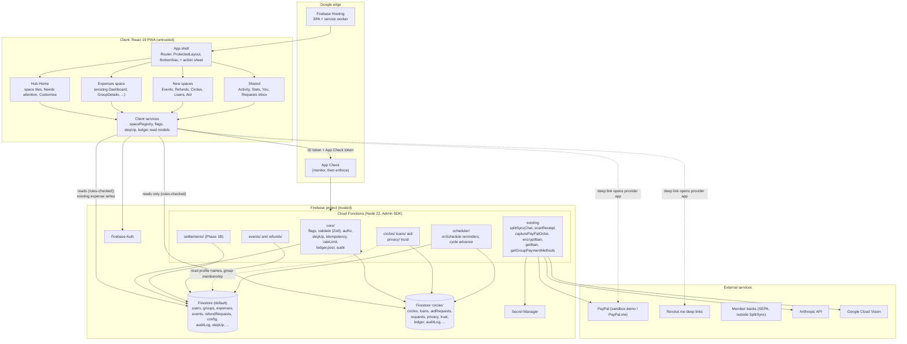
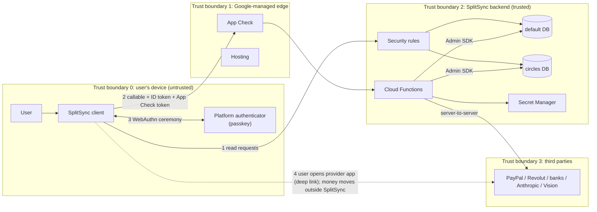
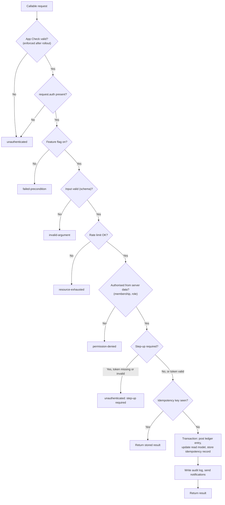
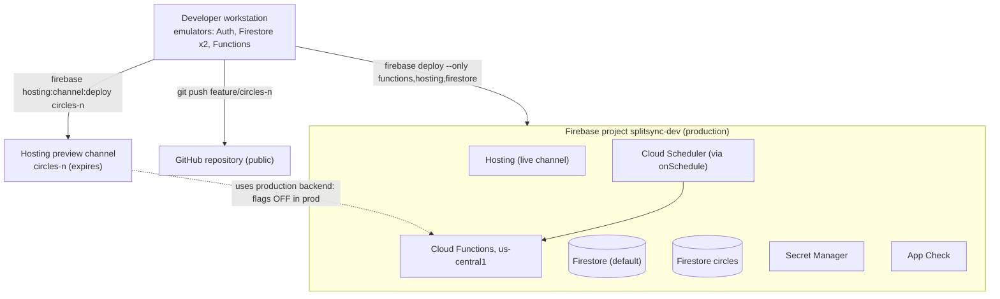

# 04. System Architecture

| | |
|---|---|
| **Document** | `docs/circles/04-system-architecture.md` |
| **Phase** | 0 (Research and Design) |
| **Depends on** | `00-codebase-audit.md` §5, `02-requirements.md` |

---

## 1. Architectural drivers

| Driver | Source | Architectural response |
|---|---|---|
| Do not break the live app | Brief §2, rule 1 | Additive modules, feature flags, the existing code paths untouched until a dedicated phase |
| Money never mixes between spaces | Brief §2, rule 2 | `spaceId` on every entry; space-scoped balance computation; separate databases for Circles, Loans and Aid |
| Same login everywhere | Brief §2, rule 3 | One Firebase Auth project. The `circles` database references users by `uid` only; profiles stay in `users`. |
| Money writes on the server | Brief §2, rule 5; decision D1 | New spaces write only through Cloud Functions; settlements migrate in Phase 1B |
| Server-verified step-up | Decision D2 | A WebAuthn challenge/verify Function pair and a re-authentication fallback |
| Kill switch | Brief §2, rule 6 | Server-enforced feature flags |
| No custody | Brief §1; `01-business-case.md` §6 | No payment flow credits a SplitSync account; PayPal Checkout restricted (`11-payments.md`) |

---

## 2. Component view

**Key properties:**

- **The client never writes to a ledger collection in either database** (except the existing Expenses expense writes, until Phase 10). It reads through rules that restrict it to the spaces and containers it belongs to.
- **Functions run with Admin SDK privileges and bypass rules.** Every Function therefore repeats authorisation from server data (`core/authz`) and validates input (`core/validate`).
- **`core/` is shared code, not a deployed endpoint.** It ensures that flags, step-up, idempotency, rate limiting, ledger posting and audit are applied the same way in every space.

---

## 3. Databases

### 3.1 Placement

| Data | Database | Rationale |
|---|---|---|
| Users, private profiles, groups, expenses, settlements, notifications, invitations | `(default)` | Existing; unchanged |
| Events, refund requests, step-up credentials and challenges, feature-flag config, default audit log | `(default)` | Events and refunds operate on expense groups and their members (Brief §1); step-up and flags serve every space |
| Circles, cycles, swaps, loans, schedules, aid requests, private aid reasons, pledges, request inbox, privacy settings, trusted and blocked lists, trust scores, Circles ledger, Circles audit log | `circles` | Isolation of the newer and riskier modules from the live expense data (Brief §1) |

Using a second named database means a defect or a mis-written rule in the Circles modules cannot expose or corrupt expense data. It also means:

- **No transaction or batched write may span both databases.** Any flow that needs data from both reads one database and writes the other, and is designed to be eventually consistent and idempotent. Examples are the trust score (reads both, writes `circles`) and account deletion (writes both, in separate idempotent steps).
- **Each database has its own rules file, indexes file and emulator tests.** `firebase.json` moves from a single `firestore` object to an array of database configurations, one per database (Firebase, n.d.-a).
- **A named database's location is fixed when it is created.** The `circles` database should be created in the same location as the default database, to keep latency and data residency consistent.

### 3.2 Client access to the named database

The client obtains the second database with `getFirestore(app, 'circles')`; the Admin SDK uses `getFirestore('circles')` (Firebase, n.d.-a). A single module, `src/services/circlesDb.js`, will export the handle, so the database identifier appears in exactly one place.

---

## 4. Trust boundaries and data flow

| Flow | Crosses | Controls |
|---|---|---|
| 1. Client reads | TB0 → TB2 | Firebase Auth ID token; default-deny rules scoped to membership |
| 2. Money actions and requests | TB0 → TB1 → TB2 | App Check; ID token; server-side schema validation; authorisation from server data; feature flag; rate limit; idempotency key; step-up token; audit log |
| 3. Step-up ceremony | Within TB0, verified in TB2 | Server-issued single-use challenge; server-side signature verification against the stored public key; short-lived step-up token |
| 4. The payment itself | TB0 → TB3 | Not handled by SplitSync. The payer's own provider authenticates them. SplitSync only records the claim, which the payee confirms. |

### 4.1 Generic money-action data flow

Every Circles, Loans, Aid, Events, Refund and (from Phase 1B) Settlement write follows the same server pipeline:

---

## 5. Cross-database consistency

| Flow | Databases | Pattern |
|---|---|---|
| Trust score recomputation | Reads both, writes `circles` | Scheduled recomputation; idempotent; tolerant of a stale input |
| Aid requests shared to an expense group | Reads `default` (group membership), writes `circles` | Membership is checked at write time and re-checked on read through the rules' copy of member IDs on the request document |
| Account deletion | Writes both | Ordered, idempotent steps: (1) check open obligations in both; (2) `circles` clean-up; (3) default clean-up; (4) delete the Auth user. Each step is safe to retry. |
| Hub "Needs attention" | Reads both | Two independent client queries merged in the UI. No combined money figure. |

---

## 6. Deployment view

**Important:** a Hosting preview channel serves new front-end code against the **production** backend. Preview testing of a new space therefore requires either:

- the feature flag switched on for an allow-listed set of test accounts only (a flag value of `{enabled: false, allowUids: [...]}`); or
- testing against the emulators.

The flag model in `10-database-design.md` supports the allow-list for this reason.

---

## 7. Technology decisions

| Decision | Choice | Alternatives considered | Reason |
|---|---|---|---|
| Feature flags | Firestore document `config/features`, readable by clients, writable by admins only, checked by `core/flags` in every Function | Firebase Remote Config | A single source both the client and Functions read through existing SDKs; per-UID allow-lists; enforcement on the server |
| Server-side validation | Zod schemas in `functions/core/schemas.js` | Hand-written checks | Declarative and testable; the same schemas could be reused on the client |
| Step-up | WebAuthn via a maintained server library (SimpleWebAuthn proposed); fallback on `auth_time` | Client-only WebAuthn (today) | A server-verifiable assertion (decision D2) |
| Scheduler | `onSchedule` Functions (2nd generation) | Client-side timers | Reliable, server-side reminders and cycle advancement |
| Money representation (new spaces) | Integer minor units (`amountMinor`) plus an ISO 4217 `currency` | Floating point (as in existing `expenses`) | Avoids rounding drift. Existing Expenses keep floats until the Phase 10 migration. |
| Draw randomness | Server `crypto.randomBytes` seed with a commit-reveal (hash stored at creation, seed revealed at start), deterministic Fisher–Yates shuffle (Knuth, 1997) | Client randomness | Verifiable by members; not manipulable by the organiser |
