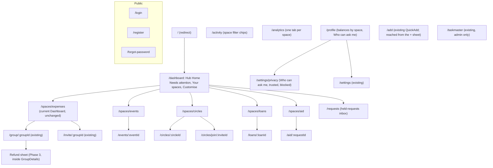
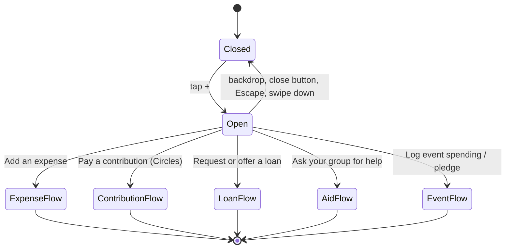

# 05. Sitemap and Navigation

| | |
|---|---|
| **Document** | `docs/circles/05-sitemap-and-navigation.md` |
| **Phase** | 0 (Research and Design) |
| **Depends on** | `00-codebase-audit.md` §6, `02-requirements.md` (`FR-HUB`), mockup `splitsync-hub.html` |

---

## 1. Principles

1. **Home becomes a hub of spaces.** Today's Home content moves, unchanged, into the Expenses space (FR-HUB-01, FR-HUB-02).
2. **Existing URLs keep working.** The hub takes over the existing `/dashboard` path. The `/dashboard` route is referenced throughout the codebase (back buttons, post-login redirects, notification links, `BottomNav`, tests), so reusing it avoids a large change to working code. The previous Home content moves to a new path, `/spaces/expenses`.
3. **The bottom navigation is unchanged in shape.** It keeps Home, Activity, the centre +, Stats and You (FR-HUB-09).
4. **Each space has one entry point** (`/spaces/:spaceId`). Containers inside a space have their own detail routes.
5. **Disabled spaces are unreachable.** When a space's flag is off, its routes redirect to the hub and its tiles and actions are hidden. The server rejects its Functions regardless (FR-CORE-01).

---

## 2. Sitemap

## 3. Route table

| Path | Screen | Status | Flag | Notes |
|---|---|---|---|---|
| `/dashboard` | `pages/Hub.jsx` (new) | **Changed meaning** | `circlesEnabled` | With the flag off, `/dashboard` renders the existing `Dashboard` exactly as today. This is the primary kill switch. |
| `/spaces/expenses` | `pages/Dashboard.jsx` (existing, unchanged) | New path | Always on | With the flag off, it redirects to `/dashboard` |
| `/spaces/:spaceId` | `pages/spaces/<Space>Home.jsx` (new) | New | Per space | Unknown or disabled `spaceId` → `/dashboard` |
| `/events/:eventId`, `/circles/:circleId`, `/loans/:loanId`, `/aid/:requestId` | Detail pages (new) | New | Per space | A non-member gets the "not a member" pattern already used by `GroupDetails` |
| `/circles/join/:inviteId` | Circle join (new) | New | `circlesSpaceEnabled` | Resumes after sign-in (same mechanism as the FR-HUB-10 invite fix) |
| `/requests` | Held-requests inbox (new) | New | `loansEnabled` or `aidEnabled` | |
| `/settings/privacy` | Who can ask me (new) | New | Same as `/requests` | |
| `/group/:groupId`, `/invite/:groupId`, `/activity`, `/analytics`, `/add`, `/profile`, `/settings`, `/taskmaster`, `/login`, `/register`, `/forgot-password` | Existing | **Unchanged paths** | | Activity, Analytics and Profile gain space-aware sections (§5) |

**Back-navigation adjustments.** Screens inside the Expenses space currently send users "back" to `/dashboard`. With the hub in place, the following targets change to `/spaces/expenses` to keep the user in the same space:

- the `GroupDetails` back arrow;
- the "not a member" screen;
- the post-delete navigation.

Each change is a single, reviewed edit with a test.

## 4. Bottom navigation and the + action sheet

| Slot | Destination | Change |
|---|---|---|
| Home | `/dashboard` (Hub) | Label and icon unchanged |
| Activity | `/activity` | Gains space filter chips |
| + (centre button) | **Opens the action sheet** (new); "Add an expense" inside the sheet opens the existing `/add` flow | The button currently navigates to `/add` directly |
| Stats | `/analytics` | Gains space tabs |
| You | `/profile` | Gains "Balances by space" and "Who can ask me" |

**Context-aware ordering (FR-HUB-05).** Inside a space, that space's actions are listed first, followed by an "Other spaces" heading. On the hub, every enabled space's primary action is listed. With `circlesEnabled` off, the + button keeps today's behaviour exactly (it navigates to `/add`).

## 5. Shared destinations made space-aware

| Destination | Today | After the change |
|---|---|---|
| Activity | Expenses across groups, with Active/Archived and All/I Paid/I Owe | Chips: All, Expenses, Events, Circles, Loans, Aid. "All" lists entries in time order, each labelled by space, with no cross-space totals. The existing filters and You Paid / You Owe cards appear under the **Expenses** chip only. |
| Stats | Five charts for expenses | One tab per enabled space. The **Expenses** tab is the existing Analytics page, unchanged. |
| You | Profile, balances per currency, payment settings | Adds "Balances by space" (per space and per currency) and "Who can ask me". Everything existing stays. |
| Notifications bell | Existing types | New types are labelled with their space and deep-link to the relevant screen |
| AI assistant | Global | Receives the current `spaceId` as context (counts only, as today) |

## 6. Flag behaviour summary

| `circlesEnabled` | Space flag | Result |
|---|---|---|
| Off | Any | The app behaves exactly as it does today (current Dashboard at `/dashboard`, + navigates to `/add`, no space chips or tabs) |
| On | Off for a space | The hub shows only the enabled spaces; the disabled space's routes redirect to `/dashboard` |
| On | On | Full behaviour |

Test accounts can be allow-listed per flag (`04-system-architecture.md` §6), so preview channels can be checked against production without exposing unfinished spaces.
