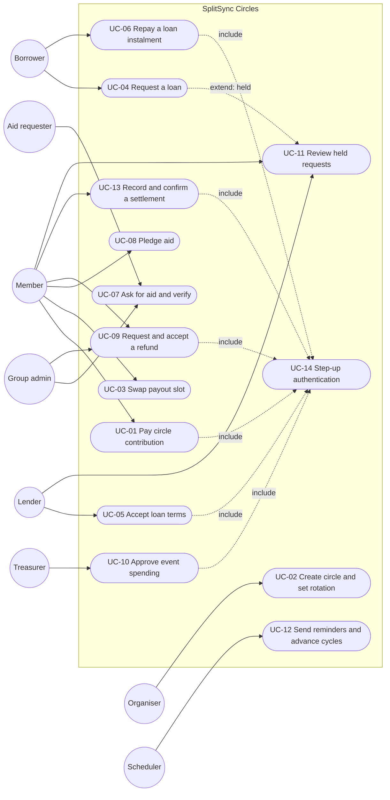

# 07. Use Cases

| | |
|---|---|
| **Document** | `docs/circles/07-use-cases.md` |
| **Phase** | 0 (Research and Design) |
| **Depends on** | `02-requirements.md` |
| **Format** | Fully dressed use cases (Cockburn, 2001) |

---

## 1. Actors

| Actor | Kind | Description |
|---|---|---|
| Member | Primary, human | Any signed-in user acting within a group, event or circle they belong to |
| Organiser | Primary, human | Creator of an event or circle. Configures it and invites members. |
| Treasurer | Primary, human | Event role assigned by the organiser. Approves spending; confirms pledged payments received. |
| Borrower | Primary, human | User requesting or holding an interest-free loan |
| Lender | Primary, human | User asked for, or providing, a loan |
| Aid requester | Primary, human | Member asking their group or circle for help |
| Group admin | Primary, human | Owner of an expense group, or organiser of a circle. Verifies aid requests; may accept refunds. |
| Payee / recipient | Supporting, human | The person receiving a payment, who confirms receipt |
| System scheduler | Primary, system | A scheduled Cloud Function: reminders, overdue marking, cycle advancement, trust recomputation |
| Platform authenticator | Supporting, system | The device passkey (WebAuthn) used for step-up |
| Payment provider | Supporting, external | PayPal, Revolut or the member's bank. Moves money outside SplitSync. |
| Platform admin | Primary, human | Taskmaster administrator (existing). May suspend users and moderate content; cannot see private data. |

## 2. Use case diagram

Mermaid has no native UML use case notation, so the diagram below uses a flowchart: actors on the left and right, use cases as rounded nodes, and «include» relationships as dotted arrows.

---

## 3. Fully dressed use cases

Common to every money use case:

- **Scope:** SplitSync (client and Cloud Functions).
- **Level:** user goal.
- **Minimal guarantee:** no ledger entry is posted twice; no balance in another space changes; every privileged action is audit-logged.

### UC-01 Pay a circle contribution

| Field | Content |
|---|---|
| Primary actor | Member (payer) |
| Stakeholders and interests | **Payer:** wants an accurate record that they paid, and no double payment. **Recipient:** wants to know who has paid. **Other members:** want the cycle to complete on time. |
| Preconditions | The payer is a member of an active circle; it is not their payout cycle; their contribution for this cycle is not yet confirmed; `circlesSpaceEnabled` is on |
| Success guarantee | A `contribution` ledger entry in the Circles ledger is marked confirmed by the recipient, and the cycle's paid count increases |
| Trigger | The payer taps "Pay EUR X to [recipient]" on the circle card, the circle detail, the hub's Needs attention list or the + sheet |

**Main success scenario**

1. The system shows the recipient, the amount, the circle and the recipient's available payment methods (from `getGroupPaymentMethods`, adapted for circles).
2. The payer chooses a method (PayPal.me, Revolut or SEPA details).
3. The system opens the provider deep link, or shows the bank details, and copies the amount (existing behaviour).
4. The payer pays outside SplitSync and returns.
5. The payer taps "I've paid".
6. The system performs **UC-14 Step-up**.
7. The client calls `circles.claimContribution` with an idempotency key.
8. The Function validates the input, checks the flag, membership, the cycle and the recipient, writes a pending lock, posts a `claimed` entry, writes the audit log, and notifies the recipient.
9. The recipient confirms receipt (`circles.confirmContribution`).
10. The system marks the entry confirmed, removes the lock, updates the cycle and notifies the payer.

**Extensions**

- **6a.** Step-up fails or is cancelled: no call is made, and the payer can retry.
- **7a.** The same idempotency key is repeated (for example a double tap): the stored result is returned and no second entry is posted.
- **8a.** A pending lock already exists for this payer and cycle: the system rejects the call with "Payment already awaiting confirmation" and shows the existing pending state.
- **9a.** The recipient declines: the entry becomes `declined`, the lock is removed, and the payer is told to check and retry. The decline counts in nobody's trust input until resolved.
- **9b.** The recipient does not respond within 7 days: the scheduler reminds the recipient, and the payer may raise a dispute (recorded only).

### UC-02 Create a circle and set the rotation

| Field | Content |
|---|---|
| Primary actor | Organiser |
| Preconditions | Signed in; the flag is on |
| Success guarantee | The circle exists with validated parameters, invitations are issued, and the payout order is fixed by a verifiable draw or by unanimous agreement before the first cycle |
| Trigger | "Start a circle" |

**Main success scenario**

1. The organiser enters the name, currency, amount, member count, frequency, start date and order method.
2. The client validates the values and shows a preview.
3. The organiser accepts the circle rules (FR-CIR-10).
4. `circles.create` validates the input on the server, creates the circle, and, for a random draw, generates a seed and stores **only its SHA-256 hash** (commit).
5. The organiser shares the invite link. Members join (each accepting the rules) until the circle is full.
6. At the start date, or when full and the organiser starts it, the scheduler or `circles.start` **reveals the seed** and computes the order with a deterministic Fisher–Yates shuffle over the members sorted by uid. The order and seed are stored, and members can verify that the revealed seed hashes to the commitment.
7. The system notifies all members of the order and the first due date.

**Extensions**

- **1a.** Out-of-range values: inline errors on the client; `invalid-argument` from the server.
- **6a.** Agreed order: the organiser proposes an order and each member accepts. Any rejection returns the proposal for revision. The circle cannot start until everyone has accepted.
- **6b.** The circle is not full at the start date: the organiser may reduce the member count (if it is still at least 3) or postpone the start.

### UC-03 Swap a payout slot

| Field | Content |
|---|---|
| Primary actor | Member (requester); supporting: the other member |
| Preconditions | Both are members; neither slot has been paid out |
| Success guarantee | The two slots are exchanged after both consent, and the change is audit-logged and visible to all members |

**Main success scenario**

1. The requester chooses a member with a future slot.
2. `circles.requestSwap` records the request and notifies the other member.
3. The other member accepts (`circles.respondSwap`).
4. The Function re-checks both slots in a transaction and swaps them.
5. All members are notified of the new order.

**Extensions**

- **3a.** Declined or expired after 72 hours: the request is closed.
- **4a.** A slot has been paid out in the meantime: the swap is rejected.

### UC-04 Request a loan (including the held-request path)

| Field | Content |
|---|---|
| Primary actor | Borrower |
| Stakeholders | **Borrower:** a clear request and a fair schedule. **Lender:** protection from unwanted requests. |
| Preconditions | The flag is on; the borrower is not blocked by the lender; within rate limits |
| Success guarantee | A loan request exists, either delivered to the lender or held in the lender's review inbox, and **the borrower's experience is identical in both cases** (FR-PRV-02) |

**Main success scenario**

1. The borrower chooses a person from the people they share a group or circle with.
2. The borrower enters the amount, number of instalments, frequency and purpose; the system previews the schedule.
3. The borrower confirms (step-up, UC-14, because the borrower accepts the proposed terms).
4. `loans.requestLoan` validates the input, checks the rate limit and block list, evaluates the lender's privacy setting, and stores the request with `delivery = 'inbox'` or `'held'`.
5. If delivered, the lender is notified. If held, the lender's held count increments and **no notification describes the request**.
6. The borrower sees "Request sent".

**Extensions**

- **4a.** The lender has blocked the borrower: the request is silently discarded, and the borrower still sees "Request sent".
- **4b.** The rate limit is exceeded: "You've sent several requests recently. Try again later."

### UC-05 Accept loan terms

| Field | Content |
|---|---|
| Primary actor | Lender |
| Preconditions | The request is pending and visible to the lender (delivered, or trusted and viewed from held) |
| Success guarantee | The loan is active with immutable, zero-interest terms that both parties accepted |

**Main success scenario**

1. The lender views the request and schedule.
2. The lender accepts and performs step-up (UC-14).
3. `loans.respond` sets the status to `accepted-awaiting-disbursement` and audit-logs it.
4. The lender pays the borrower outside SplitSync and claims the disbursement.
5. The borrower confirms receipt, and the loan becomes `active`.

**Extensions**

- **2a.** The lender declines: the borrower is notified with a neutral message.
- **4a.** The borrower declines the receipt claim: the disbursement is disputed and the loan does not activate.

### UC-06 Repay a loan instalment

As UC-01, with the borrower as payer and the lender as payee, using `loans.claimRepayment` and `loans.confirmRepayment`. On confirmation, the outstanding amount decreases. When it reaches zero, the loan is `repaid` and both parties are notified.

**Extension 1a:** the borrower requests a reschedule (FR-LON-04). The lender accepts or declines. The original schedule is kept in the history.

### UC-07 Ask for aid, with administrator verification

| Field | Content |
|---|---|
| Primary actor | Aid requester; supporting: group admin |
| Preconditions | The requester is a member of the chosen group or circle and has no other active aid request there |
| Success guarantee | A verified request is visible to members **without its reason**; the reason is readable by the verifying admin only |

**Main success scenario**

1. The requester enters the group, title, target, end date and private note.
2. `aid.createRequest` stores the public fields in `aidRequests` (status `pending-review`) and the note in `aidPrivate` (readable only by the requester and the group's admin).
3. The admin is notified, reviews the request and verifies it (`aid.review`). The admin cannot be the requester.
4. The status becomes `open`, and members are notified.

**Extensions**

- **3a.** The admin rejects it: the requester is told the reason; members see nothing.
- **3b.** The requester is the group admin: verification passes to another admin if one exists; otherwise the request cannot be shared in that group.

### UC-08 Pledge aid

1. The member opens an open aid request and enters an amount, with the anonymous toggle on by default.
2. `aid.pledge` records the pledge (the name and amount are hidden from other members if anonymous).
3. The member pays the requester directly (as UC-01 steps 2 to 4) and claims payment; the requester confirms.
4. Progress (pledged and confirmed against the target) updates.

### UC-09 Request and accept a refund

| Field | Content |
|---|---|
| Primary actor | Member (requester); supporting: payer or group owner |
| Preconditions | A non-settlement expense with a refundable remainder > 0 |
| Success guarantee | A reversing entry linked to the original expense is posted; the original is unchanged; balances reflect the reversal |

**Main success scenario**

1. The requester opens the expense, chooses "Request refund", and enters an amount and reason.
2. `refunds.request` validates the amount against the refundable remainder and stores the request.
3. The payer is notified, reviews the request (with an optional duplicate hint), accepts it, and performs step-up.
4. `refunds.decide` posts a reversal entry (`reversesEntryId` = the expense id, splits scaled proportionally) and audit-logs it.
5. Group balances update and both parties are notified.

**Extension 3a:** the payer rejects it: the requester is notified, and no entry is posted.

### UC-10 Approve event spending

1. A member submits a spend request (item, category, amount, optional receipt).
2. A treasurer who is not the requester reviews it and approves with step-up.
3. `events.decideSpend` posts an `eventSpend` entry against the category and audit-logs it. Budget against actuals updates.

**Extensions:**

- **2a.** Rejection with a reason.
- **3a.** The approval would exceed the category budget: the treasurer sees a warning and must confirm "over budget" explicitly. The over-budget flag is recorded.

### UC-11 Review held requests

1. The user opens `/requests`.
2. For each held request, the user may Decline, Block, or "Trust and view".
3. "Trust and view" adds the sender to the trusted list and opens the request as delivered.
4. Block adds the sender to the blocked list and discards their pending requests.

### UC-12 Scheduled reminders and cycle advancement (system)

1. Daily, the scheduler finds contributions and instalments due within 2 days and sends one reminder per obligation per day.
2. It marks obligations overdue after their due date.
3. It advances circles whose current cycle is fully confirmed.
4. It recomputes trust scores whose inputs changed.

All steps are idempotent per day.

### UC-13 Record and confirm a settlement (Expenses, Phase 1B)

This is today's flow, moved behind Functions. The debtor claims a payment (`settlements.claim`, with step-up and an idempotency key); the creditor confirms (`settlements.confirm`), which posts the settlement entry. A member can no longer record a settlement on someone else's behalf (FR-SET-02).

### UC-14 Step-up authentication (included use case)

1. The client requests a challenge from `stepUp.begin` with an action summary.
2. The server stores a single-use challenge bound to the uid and the action hash, with a 2-minute expiry.
3. The device performs the WebAuthn assertion (the platform authenticator verifies the user).
4. The client sends the assertion to `stepUp.complete`.
5. The server verifies the signature against the stored public key, checks the challenge and the counter, and issues a single-use step-up token valid for 5 minutes for that action.
6. The client passes the token to the money Function, which consumes it.

**Extensions:**

- **1a.** No passkey is registered, or the device cannot use one: the user re-authenticates (password or Google), and `stepUp.complete` accepts an ID token whose `auth_time` is less than 5 minutes old.
- **5a.** The verification fails: no token is issued.
