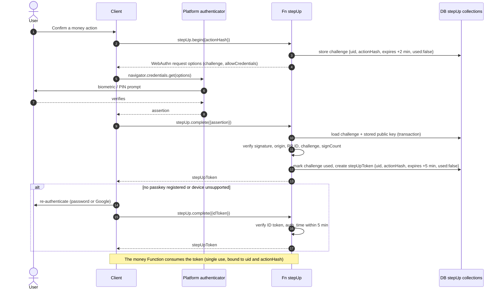
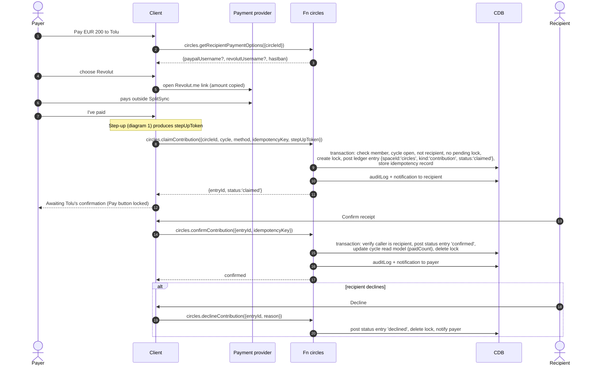
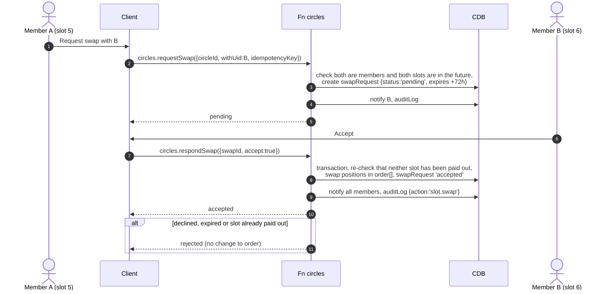
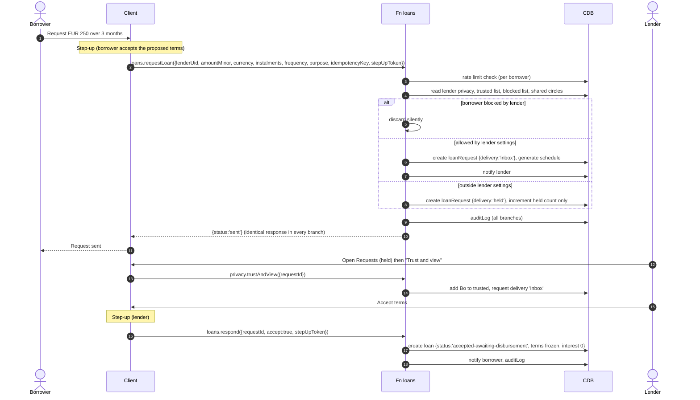
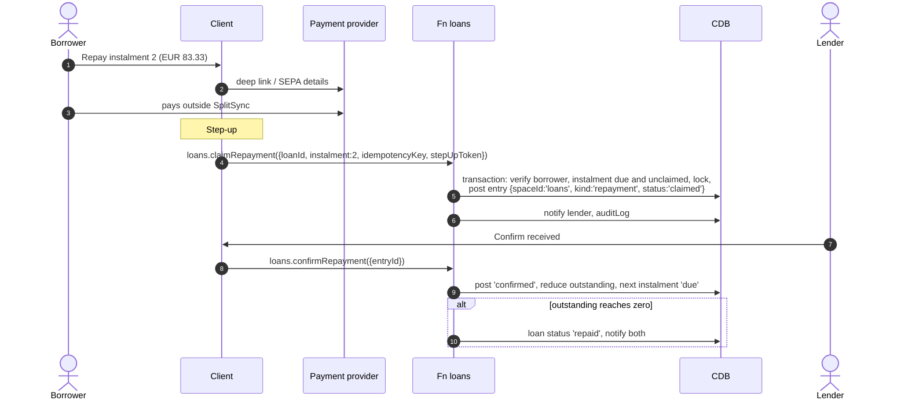
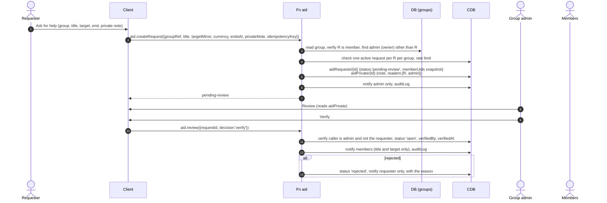
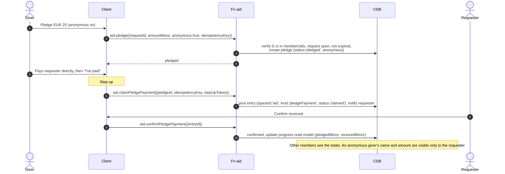
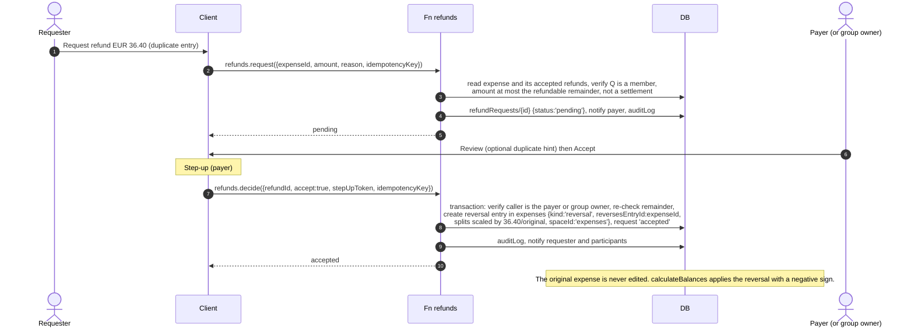
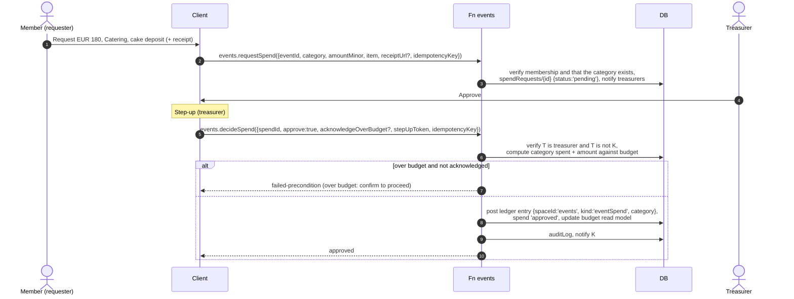
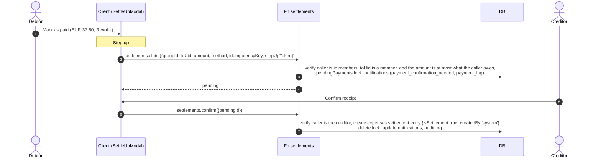

# 09. System Sequence Diagrams

| | |
|---|---|
| **Document** | `docs/circles/09-sequence-diagrams.md` |
| **Phase** | 0 (Research and Design) |
| **Depends on** | `04-system-architecture.md` §4.1 (server pipeline), `07-use-cases.md` |

**Conventions**

- `Fn` stands for the Cloud Functions boundary.
- Every Function call implicitly runs the pipeline in `04-system-architecture.md` §4.1: App Check, auth, flag, schema validation, rate limit, server-side authorisation, step-up check, idempotency.
- Function names use the grouped form `space.action`. Firebase deploys grouped exports as `space-action`.
- `DB` is the default database and `CDB` the `circles` database.

---

## 1. Step-up authentication (included in every money action)

## 2. Paying a circle contribution

## 3. Slot swap

## 4. Loan request, including the held-request path

## 5. Loan repayment

## 6. Aid request with administrator verification

## 7. Pledging aid

## 8. Refund request and acceptance (Expenses space)

## 9. Event spend approval

## 10. Settlement (Expenses, Phase 1B)

