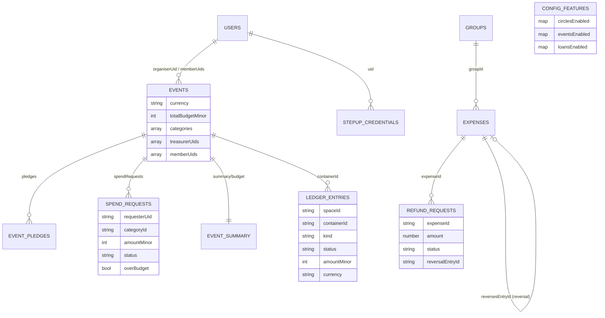
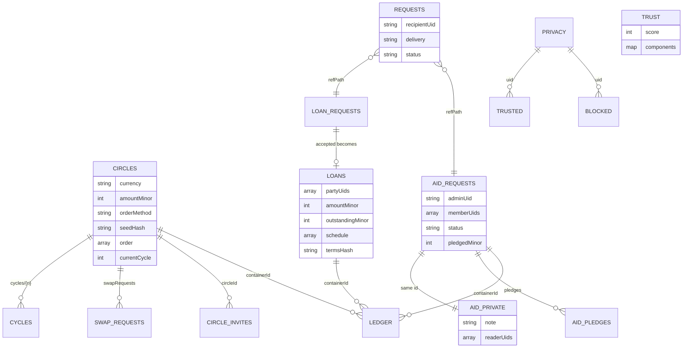

# 10. Database Design

| | |
|---|---|
| **Document** | `docs/circles/10-database-design.md` |
| **Phase** | 0 (Research and Design) |
| **Depends on** | `00-codebase-audit.md` §9 (existing model), `04-system-architecture.md` §3 |
| **Status of the rules below** | **Draft design.** They are not deployed and will be implemented and tested in the phases listed in `14-implementation-plan.md`. |

---

## 1. Modelling principles

1. **Ledger entries are immutable facts.** A status change (claimed → confirmed) is a **new** entry referencing the earlier one (`refEntryId`). Corrections are reversing entries (`reversesEntryId`). Nothing is updated or deleted (FR-CORE-06; Fowler, 2005; Kleppmann, 2017).
2. **Read models are server-maintained projections.** For example: a circle's `paidCount`, a loan's `outstandingMinor`, an aid request's `pledgedMinor`. Only Functions write them, inside the same transaction as the ledger entry that changes them.
3. **Every entry carries `spaceId` and `currency`** (FR-CORE-02). New spaces store amounts as integer minor units (`amountMinor`, so EUR 12.34 is `1234`) with an ISO 4217 `currency`. The existing `expenses` collection keeps its floating-point `amount` until Phase 10.
4. **People are referenced by `uid` only.** Display names are snapshots for history, as `formerMembers` does today. Profiles stay in `users` (Brief §2, rule 3).
5. **A field that must be hidden from some readers lives in a separate document.** Firestore rules control whole documents, not individual fields.
6. **Idempotency records live in the same database as the write they protect,** so the check and the write can share one transaction.
7. **Server-only collections deny all client access.** Functions use the Admin SDK.

---

## 2. Default database: changes and additions

### 2.1 Changes to existing collections (backwards-compatible)

| Collection | Change | Phase | Compatibility |
|---|---|---|---|
| `expenses` | New optional fields: `spaceId` (`'expenses'`), `kind` (`'expense'`, `'settlement'` or `'reversal'`), `reversesEntryId`, `idempotencyKey`, `recordedBy` | 1, 1B, 3 | Missing `spaceId` → `'expenses'`; missing `kind` → `isSettlement ? 'settlement' : 'expense'`. No data rewrite. `calculateBalances` gains reversal handling (sign −1) in Phase 3, with tests. |
| `users/{uid}` | `preferences.hiddenSpaces: string[]` | 2 | Owner-writable, like other preferences. Not sensitive. |
| `notifications` | New `type` values per space (for example `circle_due`, `loan_request`, `aid_verified`) with `data.spaceId` | 2–7 | Unknown types already render with default styling |

### 2.2 New collections (default database)

| Collection | Key fields (type) | Client access |
|---|---|---|
| `config/features` | `circlesEnabled`, `eventsEnabled`, `refundsEnabled`, `circlesSpaceEnabled`, `loansEnabled`, `aidEnabled`, `trustEnabled`: each `{enabled: bool, allowUids: string[]}`; `updatedAt` (timestamp); `updatedBy` (string) | Read: any authenticated user. Write: none (an admin Function writes with an audit record). |
| `events/{eventId}` | `name` (string ≤ 60), `currency` (ISO 4217), `totalBudgetMinor` (int), `categories` (`[{id, name, budgetMinor}]`), `organiserUid`, `treasurerUids` (string[]), `memberUids` (string[]), `members` (`[{uid, name}]`), `status` (`'planning'`, `'active'` or `'closed'`), `createdAt` | Read: members. Write: none (Functions). |
| `events/{id}/pledges/{pledgeId}` | `uid`, `amountMinor`, `status` (`'pledged'`, `'paid-claimed'`, `'confirmed'`, `'declined'`), `createdAt` | Read: members. Write: none. |
| `events/{id}/spendRequests/{sid}` | `requesterUid`, `categoryId`, `item` (≤ 80), `amountMinor`, `receiptUrl?`, `status` (`'pending'`, `'approved'` or `'rejected'`), `decidedBy?`, `decidedAt?`, `overBudget` (bool), `reason?` | Read: members. Write: none. |
| `events/{id}/summary/budget` | Read model: `spentByCategory` (map id→int), `spentMinor`, `pledgedMinor`, `receivedMinor` | Read: members. Write: none. |
| `ledgerEntries/{entryId}` | Common ledger for the **Events** space in the default database (§4) | Read: members of the container. Write: none. |
| `refundRequests/{rid}` | `groupId`, `expenseId`, `requesterUid`, `amount` (number, matching `expenses`), `reason` (enum), `note?` (≤ 200), `status`, `decidedBy?`, `reversalEntryId?`, `createdAt` | Read: group members. Write: none. |
| `stepUpCredentials/{credentialId}` | `uid`, `publicKey` (bytes), `counter` (int), `transports` (string[]), `createdAt`, `lastUsedAt` | None (server only) |
| `stepUpChallenges/{cid}` | `uid`, `actionHash`, `challenge`, `expiresAt`, `used` | None |
| `stepUpTokens/{tid}` | `uid`, `actionHash`, `expiresAt`, `used` | None |
| `locks/{lockId}` | Pending-payment locks for Events pledges (`evt_{eventId}_{uid}_{pledgeId}`): `uid`, `entryId`, `createdAt`. The existing `pendingPayments` stays as is for Expenses. | Read: the lock owner (to show the locked state). Write: none. |
| `idempotency/{uid}_{key}` | `fn`, `requestHash`, `result` (map), `createdAt`; deleted after 7 days by the scheduler | None |
| `rateLimits/{uid}_{action}_{window}` | `count`, `windowStart` | None |
| `auditLog/{id}` | `actorUid`, `action`, `spaceId`, `targetPath`, `requestId`, `at`, `meta` (no amounts tied to names, no personal data beyond uids) | Read: platform admins. Write: none. |

---

## 3. `circles` database collections

| Collection | Key fields (type) | Client access |
|---|---|---|
| `circles/{circleId}` | `name` (3–40), `currency`, `amountMinor` (1000–200000), `frequency` (`'weekly'`, `'fortnightly'` or `'monthly'`), `memberLimit` (3–20), `startDate`, `status` (`'forming'`, `'active'`, `'completed'` or `'cancelled'`), `organiserUid`, `memberUids` (string[]), `members` (`[{uid, name, joinedAt, acknowledgedAt}]`), `orderMethod` (`'random'` or `'agreed'`), `seedHash` (hex), `seed` (hex or null until reveal), `order` (string[] uids), `currentCycle` (int), `guarantorRequired` (bool), `paidCount` (int, read model), `createdAt` | Read: members. Write: none. |
| `circles/{id}/cycles/{n}` | `recipientUid`, `dueDate`, `status` (`'open'`, `'complete'` or `'overdue'`), `claimedUids`, `confirmedUids` (read model) | Read: members. Write: none. |
| `circles/{id}/swapRequests/{sid}` | `fromUid`, `toUid`, `fromSlot`, `toSlot`, `status`, `expiresAt` | Read: members. Write: none. |
| `circleInvites/{inviteId}` | `circleId`, `circleName`, `createdBy`, `expiresAt`, `revoked` | Read: authenticated users (preview, like `groups` today). Write: none. |
| `loanRequests/{rid}` | `borrowerUid`, `lenderUid`, `amountMinor`, `currency`, `instalments` (int 1–12), `frequency`, `purpose` (5–80), `schedule` (`[{n, dueDate, amountMinor}]`), `status` (`'pending'`, `'accepted'`, `'declined'` or `'withdrawn'`), `createdAt`. **No delivery or visibility field of any kind.** Any such field would let the borrower infer that the request was held (FR-PRV-02). | Read: **borrower only**. The lender sees the request through their own `requests` inbox item, which carries a `summary` snapshot. Write: none. |
| `loans/{loanId}` | `borrowerUid`, `lenderUid`, `partyUids` (string[2]), `amountMinor`, `currency`, `schedule` (`[{n, dueDate, amountMinor, status}]`), `outstandingMinor`, `status` (`'accepted-awaiting-disbursement'`, `'active'`, `'repaid'` or `'disputed'`), `termsHash` (hex), `termsAcceptedAt` (`{borrower, lender}`), `interestMinor` (always 0; asserted on the server) | Read: parties. Write: none. |
| `aidRequests/{aid}` | `groupRef` (`{db: 'default' or 'circles', id}`), `requesterUid`, `adminUid`, `memberUids` (string[], snapshot), `title` (5–60), `targetMinor` (2000–1000000), `currency`, `endsAt`, `status` (`'pending-review'`, `'open'`, `'closed'` or `'rejected'`), `verifiedBy?`, `pledgedMinor`, `receivedMinor`, `giverCount` (read model) | Read: requester and admin always; members only when `status` is `'open'` or `'closed'`. Write: none. |
| `aidPrivate/{aid}` | `note` (≤ 1,000), `readerUids` (`[requesterUid, adminUid]`), `deleteAfter` (closure + 90 days) | Read: `readerUids` only. Write: none. |
| `aidRequests/{aid}/pledges/{pid}` | `uid`, `amountMinor`, `anonymous` (bool), `status` | Read: the giver (own) and the requester. Members see aggregates only. Write: none. |
| `requests/{qid}` (inbox items) | `recipientUid`, `senderUid`, `senderName` (snapshot), `kind` (`'loan'` or `'aid'`), `refPath`, `summary` (snapshot shown to the recipient, for example `{amountMinor, currency, instalments, frequency, purpose, schedule}`), `delivery` (`'inbox'` or `'held'`), `status` (`'new'`, `'viewed'`, `'declined'` or `'blocked'`), `createdAt` | Read: recipient only. Write: none (actions go through Functions). |
| `privacy/{uid}` | `loans`, `aid`, `direct` (`'nobody'`, `'trusted'`, `'shared'` or `'groups'`), `holdOthers` (bool) | Read and write: owner, with value validation in the rules (not money-affecting). Defaults: `trusted`, `trusted`, `groups`, `true`. |
| `trusted/{uid}/people/{otherUid}`, `blocked/{uid}/people/{otherUid}` | `addedAt` | Read and write: owner |
| `trust/{uid}` | `score` (0–100), `components` (`{contributionsOnTime, contributionsTotal, repaymentsOnTime, repaymentsTotal, monthsActive, upheldDisputes}`), `updatedAt` | Read: owner only. Other members read a score through `trust.get`, which checks for a shared circle (FR-TRU-02). Write: none. |
| `ledger/{entryId}` | Common ledger for **Circles, Loans and Aid** (§4) | Read: parties or members of the container. Write: none. |
| `locks/{lockId}` | Pending-payment locks for Circles, Loans and Aid (`cir_`, `lon_`, `aid_` key formats in `11-payments.md` §3): `uid`, `entryId`, `createdAt` | Read: the lock owner. Write: none. |
| `idempotency/{uid}_{key}`, `rateLimits/...`, `auditLog/{id}` | As in the default database | None (`auditLog`: platform admins may read) |

---

## 4. Ledger entry model

```text
LedgerEntry {
  entryId:        string            // Firestore id
  spaceId:        'events' | 'circles' | 'loans' | 'aid'   // 'expenses' entries stay in `expenses`
  containerType:  'event' | 'circle' | 'loan' | 'aid'
  containerId:    string
  kind:           'contribution' | 'disbursement' | 'repayment' | 'pledgePayment' | 'eventSpend' | 'eventPledgePayment' | 'reversal'
  status:         'claimed' | 'confirmed' | 'declined' | 'posted'   // 'posted' for single-step entries (eventSpend)
  refEntryId:     string | null     // the claim this confirmation/decline refers to
  reversesEntryId:string | null     // for reversals
  fromUid:        string | null     // payer
  toUid:          string | null     // payee
  amountMinor:    int  (> 0)
  currency:       string (ISO 4217, equal to the container's currency)
  method:         'paypal_me' | 'revolut' | 'sepa' | 'manual' | null
  cycle | instalment: int | null
  memberUids:     string[]          // copy of the container's readers, used by the rules
  idempotencyKey: string
  createdBy:      string            // uid of the acting user
  createdAt:      server timestamp
  schemaVersion:  1
}
```

**Balance computation** (pure functions, unit-tested):

- **Circles:** for cycle *n*, a member's status is the latest entry among `contribution` entries with `cycle = n` and `fromUid = member`.
- **Loans:** `outstandingMinor = amountMinor − Σ(confirmed repayments)`, provided the disbursement is confirmed.
- **Aid:** `receivedMinor = Σ(confirmed pledgePayment)`.
- **Events:** `spentByCategory[c] = Σ(eventSpend posted) − Σ(reversals)`.
- **Expenses:** the existing `calculateBalances`, extended so that `kind = 'reversal'` contributes with a negative sign, scaled to the refunded fraction.

All computations filter by `spaceId`, `containerId` and `currency` before summing. This makes cross-space or cross-currency totals impossible by construction (FR-CORE-03).

---

## 5. Entity relationship diagrams

### 5.1 Default database (new and changed, alongside the existing model in `00-codebase-audit.md` §9)



### 5.2 `circles` database



---

## 6. Indexes (`firestore.indexes.json`; one file per database)

| Database | Collection | Fields | Query served |
|---|---|---|---|
| default | `ledgerEntries` | `containerId` ASC, `createdAt` DESC | Event ledger, newest first |
| default | `events` | `memberUids` CONTAINS, `createdAt` DESC | My events |
| default | `refundRequests` | `groupId` ASC, `status` ASC, `createdAt` DESC | Pending refunds in a group |
| default | `expenses` | `reversesEntryId` ASC | Refunds of an expense |
| circles | `circles` | `memberUids` CONTAINS, `status` ASC | My active circles |
| circles | `ledger` | `containerId` ASC, `createdAt` DESC | Container history |
| circles | `ledger` | `memberUids` CONTAINS, `createdAt` DESC | Activity feed for Circles, Loans and Aid |
| circles | `loans` | `partyUids` CONTAINS, `status` ASC | My loans |
| circles | `aidRequests` | `memberUids` CONTAINS, `status` ASC, `endsAt` ASC | Open aid in my groups |
| circles | `requests` | `recipientUid` ASC, `status` ASC, `createdAt` DESC | Inbox |
| circles | `cycles` (collection group) | `dueDate` ASC, `status` ASC | Scheduler: upcoming and overdue |

The scheduler's collection-group query needs a collection-group index.

---

## 7. Security rules (draft)

### 7.1 Default database: additions to `firestore.rules`

```javascript
// ---- Phase 1: config, server-only collections -------------------------
match /config/features { allow read: if request.auth != null; allow write: if false; }
match /stepUpCredentials/{id} { allow read, write: if false; }
match /stepUpChallenges/{id}  { allow read, write: if false; }
match /stepUpTokens/{id}      { allow read, write: if false; }
match /idempotency/{id}       { allow read, write: if false; }
match /rateLimits/{id}        { allow read, write: if false; }
match /auditLog/{id}          { allow read: if isAdmin(); allow write: if false; }

// ---- Phase 1B: settlements are Function-only --------------------------
// Added to the existing expenses `create` condition:
//   && request.resource.data.get('isSettlement', false) == false
//   && request.resource.data.get('kind', 'expense') == 'expense'
// Added to the existing `update` condition: kind and isSettlement are immutable.

// ---- Phase 3: events and refunds (read-only for members) -------------
function isEventMember(eventId) {
  return request.auth != null &&
    request.auth.uid in get(/databases/$(database)/documents/events/$(eventId)).data.memberUids;
}
match /events/{eventId} {
  allow read: if request.auth != null && request.auth.uid in resource.data.memberUids;
  allow write: if false;
  match /{sub=**} { allow read: if isEventMember(eventId); allow write: if false; }
}
match /ledgerEntries/{id} {
  allow read: if request.auth != null && request.auth.uid in resource.data.memberUids;
  allow write: if false;
}
match /refundRequests/{id} {
  allow read: if isGroupMember(resource.data.groupId);
  allow write: if false;
}
```

### 7.2 `circles` database: new file `firestore.circles.rules`

```javascript
rules_version = '2';
service cloud.firestore {
  match /databases/{database}/documents {
    function signedIn() { return request.auth != null; }
    function isAdmin()  { return signedIn() && request.auth.token.admin == true; }
    function me()       { return request.auth.uid; }

    // Containers: members read; nobody writes from the client
    match /circles/{circleId} {
      allow read: if signedIn() && me() in resource.data.memberUids;
      allow write: if false;
      match /{sub=**} {
        allow read: if signedIn() &&
          me() in get(/databases/$(database)/documents/circles/$(circleId)).data.memberUids;
        allow write: if false;
      }
    }
    match /circleInvites/{id} { allow read: if signedIn(); allow write: if false; }

    // Borrower only. The lender reads the summary in their own `requests` item,
    // so nothing the borrower can read reveals whether the request was held.
    match /loanRequests/{id} {
      allow read: if signedIn() && resource.data.borrowerUid == me();
      allow write: if false;
    }
    match /loans/{id} {
      allow read: if signedIn() && me() in resource.data.partyUids;
      allow write: if false;
    }

    match /aidRequests/{aid} {
      allow read: if signedIn() && (
        resource.data.requesterUid == me() || resource.data.adminUid == me() ||
        (me() in resource.data.memberUids && resource.data.status in ['open', 'closed']));
      allow write: if false;
      match /pledges/{pid} {
        allow read: if signedIn() && (resource.data.uid == me() ||
          get(/databases/$(database)/documents/aidRequests/$(aid)).data.requesterUid == me());
        allow write: if false;
      }
    }
    match /aidPrivate/{aid} {
      allow read: if signedIn() && me() in resource.data.readerUids;
      allow write: if false;
    }

    // Inbox: the recipient only; the sender can never learn delivery status
    match /requests/{id} {
      allow read: if signedIn() && resource.data.recipientUid == me();
      allow write: if false;
    }

    // Owner-managed, non-money settings
    match /privacy/{uid} {
      allow read: if signedIn() && uid == me();
      allow write: if signedIn() && uid == me() &&
        request.resource.data.keys().hasOnly(['loans', 'aid', 'direct', 'holdOthers']) &&
        request.resource.data.loans  in ['nobody', 'trusted', 'shared', 'groups'] &&
        request.resource.data.aid    in ['nobody', 'trusted', 'shared', 'groups'] &&
        request.resource.data.direct in ['nobody', 'trusted', 'shared', 'groups'] &&
        request.resource.data.holdOthers is bool;
    }
    match /trusted/{uid}/people/{other} { allow read, write: if signedIn() && uid == me() && other != me(); }
    match /blocked/{uid}/people/{other} { allow read, write: if signedIn() && uid == me() && other != me(); }

    match /trust/{uid} { allow read: if signedIn() && uid == me(); allow write: if false; }

    // Ledger: members of the container read; append-only, server-written
    match /ledger/{id} {
      allow read: if signedIn() && me() in resource.data.memberUids;
      allow write: if false;
    }

    match /locks/{id}       { allow read: if signedIn() && resource.data.uid == me(); allow write: if false; }
    match /idempotency/{id} { allow read, write: if false; }
    match /rateLimits/{id}  { allow read, write: if false; }
    match /auditLog/{id}    { allow read: if isAdmin(); allow write: if false; }

    match /{document=**} { allow read, write: if false; }
  }
}
```

**Required rules tests** (`13-test-strategy.md` §4): for every collection, each of the following must be tested:

- an owner or party;
- a member;
- a non-member;
- an unauthenticated user;
- an admin, who must **not** read `aidPrivate`, `requests` or `privacy`;
- a tampered write (every client write is denied, including by members and admins).

Plus queries: "my circles" and "my inbox" must succeed; a broad collection read must fail.

---

## 8. Data lifecycle and privacy

| Data | Retention | Erasure on account deletion (FR-DAT-02) |
|---|---|---|
| Ledger entries | Kept, because they are other members' financial history | The uid is retained; a name snapshot is kept in `formerMembers` or the container `members` |
| `aidPrivate` notes | Deleted 90 days after the request closes (scheduler) | Deleted immediately if the requester deletes their account |
| `requests`, `privacy`, `trusted`, `blocked`, `trust` | While the account exists | Deleted |
| `stepUpCredentials` | While the account exists; removable from Settings | Deleted |
| `idempotency`, `rateLimits`, used `stepUp*` | 7 days, 1 day, and 1 day respectively (scheduler) | Deleted |
| `auditLog` | 1 year | uid retained (a legitimate interest in security records); no other personal data stored |
