# 14. Implementation Plan

| | |
|---|---|
| **Document** | `docs/circles/14-implementation-plan.md` |
| **Phase** | 0 (Research and Design) |
| **Depends on** | All previous documents; decisions D1 to D4 (`00-codebase-audit.md` §15) |

Every phase follows the loop in `03-frameworks-and-methodology.md` §1.2 and the Definition of Done in §1.3. Each phase works on a branch `feature/circles-<phase>`, deploys to a preview channel `circles-<phase>`, and is merged only after the product owner has approved it. Flags stay **off** in production until the product owner switches them on.

---

## Phase overview

```mermaid
flowchart LR
  P05["0.5 Pre-work"] --> P1["1 Foundations"] --> P1B["1B Settlements via Functions"] --> P2["2 Hub and navigation"]
  P2 --> P3["3 Refunds and Events"] --> P4["4 Circles"] --> P5["5 Request privacy"] --> P6["6 Loans"] --> P7["7 Aid"] --> P8["8 Trust and analytics"] --> P9["9 Hardening review"] --> P10["10 Expenses writes via Functions"]
```

| Phase | Scope | Main risk to the live app | Exit criteria (beyond the Definition of Done) |
|---|---|---|---|
| 0.5 | Routing tests; invite redirect fix; `react-router-dom` 7.x patch; pinned versions | Low | `App.js` covered; signed-out invites resume after sign-in |
| 1 | Flags, `core/` Function helpers, step-up, `circles` database, rules and indexes, `spaceId` read default, App Check (monitor) | Low (additive) | Pipeline and step-up tests green; `circles` rules tests green |
| 1B | Settlement claim and confirm moved to Functions | **Medium** (touches SettleUpModal and GroupDetails) | All settlement suites green; clients denied direct settlement writes |
| 2 | Hub Home; Expenses space; + sheet; Activity, Stats and You by space; Customise | **Medium** (routing, Home) | Flag-off parity suite green; Dashboard suite green at its new path |
| 3 | Refunds; Events | Low to medium (balance calculator) | Reversal and separation tests green |
| 4 | Circles | Low (new database) | Draw verification; contribution and swap flows; scheduler |
| 5 | Privacy settings, trusted and blocked lists, held inbox | Low | Held-path indistinguishability tests |
| 6 | Loans | Low | Terms freeze; zero-interest assertion |
| 7 | Aid | Low | `aidPrivate` isolation; anonymous pledges |
| 8 | Trust score; per-space Stats | Low | Visibility tests; never used for authorisation |
| 9 | Security and accessibility review; App Check enforcement; headers proposal; documentation | Medium (CSP, App Check) | No open high-severity findings; WCAG 2.2 AA checklist complete |
| 10 | Ordinary expense writes via Functions (decision D1) | **High** (core flows) | Full parity, then client expense writes denied |

---

## Phase 0.5: Pre-work

| Action | Files |
|---|---|
| Create | `src/App.test.js` (route guards, redirects, ProtectedLayout visibility, suspension sign-out, `lastActive` once per day) |
| Change | `src/App.js` (preserve the intended route through `/login` and `/register`, for example via router state or `sessionStorage`), `src/pages/Login.jsx`, `src/pages/Register.jsx` (navigate to the preserved route instead of always `/dashboard`) |
| Change | `package.json` and lock file (`react-router-dom` within 7.x; exact pinned versions) |
| Tests | New App tests; Login, Register and JoinGroup suites updated for the redirect |

## Phase 1: Foundations

| Area | Create | Change |
|---|---|---|
| Flags | `src/hooks/useFeatureFlags.js`, `src/config/spaces.js` (space registry: id, name, icon, accent, routes, flag) | — |
| Named database | `src/services/circlesDb.js` | `firebase.json` (multi-database `firestore` array; indexes), `.gitignore` if needed |
| Rules and indexes | `firestore.circles.rules`, `firestore.indexes.json`, `firestore.circles.indexes.json`, `firestore-tests/circles.rules.test.js` | `firestore.rules` (config, server-only collections), `firestore-tests/rules.test.js` |
| Server core | `functions/core/flags.js`, `schemas.js` (Zod), `authz.js`, `stepUp.js`, `idempotency.js`, `rateLimit.js`, `ledger.js`, `audit.js`, `errors.js` | `functions/index.js` (grouped exports), `functions/package.json` (Zod, the WebAuthn server library, pinned) |
| Step-up | `functions/stepUp/index.js` (`stepUp.begin`, `stepUp.complete`, `stepUp.registerBegin`, `stepUp.registerComplete`), `src/utils/stepUp.js`, `src/components/StepUpSheet.jsx` | `src/pages/Settings.jsx` (register or remove a passkey for step-up; the existing device biometric stays) |
| Admin flags | `functions/admin/setFlag.js` (admin claim required; audit-logged) | `src/pages/Taskmaster.jsx` (a Flags section) |
| Space default | — | `src/utils/balanceCalculator.js` (treat a missing `spaceId` as `'expenses'`; documentation only, no behaviour change) |
| App Check | `src/services/appCheck.js` (monitor mode) | `src/services/firebase.js`, `src/index.js` |
| Tests | `functions/core/*.test.js`, `functions/test/integration/stepUp.test.js`, rules tests for both databases, `useFeatureFlags.test.js`, `StepUpSheet.test.jsx` | |
| Docs | — | `projectdoc.md`, `functions/assistantPrompt.js` (only when user-visible features ship) |

## Phase 1B: Settlements via Functions (decision D1)

| Action | Files |
|---|---|
| Create | `functions/settlements/index.js` (`settlements.claim`, `settlements.confirm`, `settlements.decline`, `settlements.cancel`), integration tests |
| Change | `src/components/SettleUpModal.jsx` (call the Functions instead of `addDoc` and `setDoc`), `src/stores/notificationsStore.js` (`confirmPaymentReceived` and `declinePaymentReceived` call the Functions), `src/pages/GroupDetails.jsx` (cancel lock through the Function) |
| Change | `firestore.rules` (deny client `isSettlement` creates; `pendingPayments` becomes server-written) |
| Tests | SettleUpModal, GroupDetails (4 suites) and notificationsStore (2 suites) updated; rules tests; separation tests |
| Note | The PayPal sandbox guard (`11-payments.md` §2.1) is added to `capturePayPalOrder` in this phase |

## Phase 2: Hub and navigation

| Action | Files |
|---|---|
| Create | `src/pages/Hub.jsx`, `src/pages/spaces/ExpensesSpace.jsx` (a wrapper that renders the existing `Dashboard` with a space header), `src/components/hub/SpaceTile.jsx`, `NeedsAttention.jsx`, `CustomiseHomeSheet.jsx`, `src/components/ActionSheet.jsx`, `src/components/SpaceChips.jsx` |
| Change | `src/App.js` (routes in `05-sitemap-and-navigation.md` §3), `src/components/BottomNav.jsx` (+ opens the action sheet when the flag is on), `src/pages/Activity.jsx`, `src/pages/Analytics.jsx` (space chips and tabs; existing content becomes the Expenses tab), `src/pages/Profile.jsx` (Balances by space, Who can ask me card), `src/pages/GroupDetails.jsx` (back targets), `tailwind.config.js` (space accents, `fade-in`, `sheet-in`, `fill-x`) |
| Unchanged | `src/pages/Dashboard.jsx` |
| Tests | Hub, tiles, action sheet, flag-off parity suite; BottomNav, Activity, Analytics, Profile and Dashboard suites updated for routes |

## Phase 3: Refunds and Events (default database)

| Action | Files |
|---|---|
| Create | `functions/refunds/index.js`, `functions/events/index.js`, `src/pages/spaces/EventsHome.jsx`, `src/pages/EventDetails.jsx`, `src/components/events/*`, `src/components/refunds/RefundRequestSheet.jsx`, `RefundReviewSheet.jsx`, `src/utils/ledgerViews.js` (pure projections) |
| Change | `src/utils/balanceCalculator.js` (reversal handling), `src/components/ExpenseDetailsModal.jsx` (Request refund), `src/pages/GroupDetails.jsx` (refund rows and review), `firestore.rules` (events, ledgerEntries, refundRequests; deny client reversals), `firestore.indexes.json` |
| Tests | balanceCalculator reversal cases; refund and event integration tests; rules tests; ExpenseDetailsModal coverage raised first |

## Phase 4: Circles (`circles` database)

| Action | Files |
|---|---|
| Create | `functions/circles/index.js` (create, join, start or draw, proposeOrder, acceptOrder, claim, confirm, decline, requestSwap, respondSwap, getRecipientPaymentOptions), `functions/circles/draw.js` (commit-reveal and Fisher–Yates), `functions/scheduler/index.js` (`onSchedule`: reminders, overdue, cycle advance, retention clean-up), `src/pages/spaces/CirclesHome.jsx`, `src/pages/CircleDetails.jsx`, `src/pages/CircleJoin.jsx`, `src/components/circles/*` (RotationTimeline, CreateCircleSheet, PayContributionSheet, SwapSheet, VerifyDrawSheet) |
| Change | `functions/getIban` (accept a circle reference), `firestore.circles.rules`, `firestore.circles.indexes.json`, `src/App.js` (routes) |
| Tests | Draw unit tests; integration tests for every Function; scheduler tests with a fake clock; rules tests |

## Phase 5: Request privacy

| Action | Files |
|---|---|
| Create | `functions/privacy/index.js` (`triage` helper, `trustAndView`, `decline`, `block`, `unblock`), `src/pages/Requests.jsx`, `src/pages/PrivacySettings.jsx`, `src/components/privacy/*` |
| Change | `src/pages/Profile.jsx` (Who can ask me), `src/pages/Hub.jsx` (held badge), `firestore.circles.rules` |
| Tests | Held-path indistinguishability (the sender's responses and readable documents are identical); block discards; defaults |

## Phase 6: Loans

| Action | Files |
|---|---|
| Create | `functions/loans/index.js`, `functions/loans/schedule.js`, `src/pages/spaces/LoansHome.jsx`, `src/pages/LoanDetails.jsx`, `src/components/loans/*` |
| Tests | Schedule sums; terms freeze; zero interest; privacy triage integration; reminder rate limit |

## Phase 7: Aid

| Action | Files |
|---|---|
| Create | `functions/aid/index.js`, `src/pages/spaces/AidHome.jsx`, `src/pages/AidDetails.jsx`, `src/components/aid/*` (including AdminReviewSheet) |
| Change | `firestore.circles.rules` (`aidPrivate`, pledges), scheduler (90-day note deletion), `src/utils/accountDeletion.js` (circles obligations) |
| Tests | `aidPrivate` isolation (members, other admins, platform admins all denied); anonymous pledge visibility; one active request per group |

## Phase 8: Trust score and per-space analytics

| Action | Files |
|---|---|
| Create | `functions/trust/index.js` (`recompute` scheduled job, `trust.get` with a shared-circle check), `src/components/trust/*`, Stats tab components per space |
| Tests | Formula unit tests; visibility; never consulted by authorisation (static check) |

## Phase 9: Hardening review

- Enforce App Check after reviewing the monitoring metrics.
- Propose CSP and security headers in a separate change, tested on a preview channel; bump the service worker cache.
- A WCAG 2.2 AA audit of all new screens.
- A dependency upgrade review (`npm audit`, no `--force`).
- Data export (FR-DAT-01) and erasure across both databases (FR-DAT-02).
- Update `projectdoc.md`, the README, and the assistant prompt for all spaces.

## Phase 10: Ordinary expense writes via Functions (decision D1)

- `functions/expenses/index.js` (create, edit, archive, restore, soft delete) with parity tests.
- AddExpenseModal and ExpenseDetailsModal call the Functions.
- Rules finally deny all client writes to `expenses`.
- An optional migration converts `amount` to `amountMinor` with a dual-read period.

---

## Dead code and clean-up reminders (from `00-codebase-audit.md` §12)

These items will be raised for approval at the end of the phase that touches each area. Nothing is deleted without approval.

- `ProfilePhotoUpload.jsx` and `useKeyboardAware.js` (unused)
- The `tesseract.js` dependency and the root `crypto-js`
- The unused utility exports listed in the audit
- The duplicate public assets and `public/test-results.txt`
- `GroupDetails_new.test.jsx` (overlapping suite)
- The `firebase-functions-test` devDependency
- Regeneration of the stale Doxygen output
